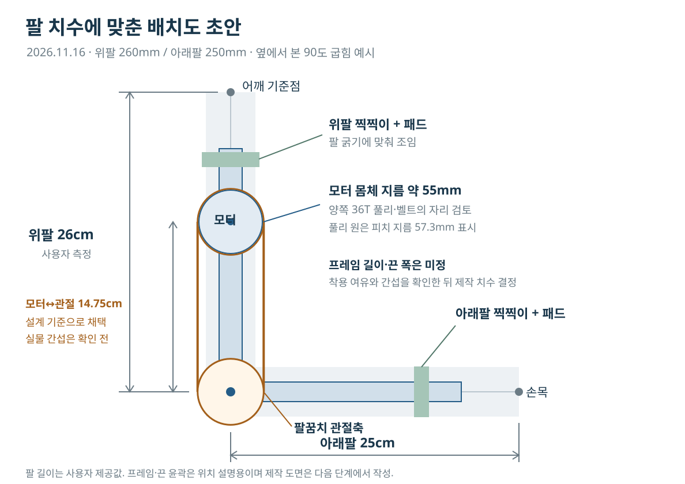

# Second Muscle | 함께 만드는 친구에게

우리 팀 **‘보조로봇으로 회춘하다’**는 팔꿈치를 굽힐 때 힘을 보태는 로봇을 만든다. 한쪽 팔로 3~5kg 덤벨을 들 때 필요한 힘의 약 30%를 모터가 보조하는 게 목표다. 첫 시연은 **사람 대신 시험대에 고정한 모형 팔**로 한다. 한 번 충전해서 굽히기·잠시 유지하기·원위치·대기를 반복하며 약 15분 동안 동작하는 모습을 보여주려 한다.

**11월 21일 기준** 알씨뱅크 물품은 받았고, 디바이스마트에는 Damiao DM4340P 24V 모터를 포함한 부품을 구매 요청했다. 지금 둘이 할 일은 위팔·아래팔 프레임과 팔 받침을 한꺼번에 출력할 견적을 받는 것이다. [출력 ZIP](docs/assembly/forearm_fit/팔꿈치로봇_일괄시험출력.zip)에는 STL 9종이 있다. 위팔 받침 U31만 2개로 지정하면 총 10개다.

먼저 [부품 그림과 손 조립 순서](docs/assembly/forearm_fit/조립과_견적.md)를 함께 본다. 출력물이 오면 가벼운 프레임을 손으로 굽혀 관절 위치와 찍찍이를 맞춘다. 모터 체결은 모터를 받은 뒤 탁자 위에서 확인한다. 금속 축 가공과 동력 시험은 그 뒤 단계다.

## 팔을 어떻게 움직이나

1. **팔을 굽히려는 신호를 읽는다.** 이두근에 붙이는 전극에서 근전도(EMG)를 읽는다. Grove EMG 센서 한 개가 낸 아날로그 신호를 ADS1115가 숫자로 바꾸고, ESP32 제어보드가 읽는다. 이 신호는 보조를 요청하는 입력이다. 힘·속도·각도 제한은 제어기에서 별도로 둔다.
2. **팔꿈치까지 힘을 전달한다.** ESP32가 CAN 통신 모듈을 거쳐 상완(위팔)에 고정된 모터에 명령을 보낸다. 모터의 톱니바퀴인 **풀리**가 타이밍벨트를 당기면 팔꿈치 쪽 풀리와 독립 관절축이 회전하고, 그 축에 고정된 전완(아래팔) 프레임이 따라 움직인다. 베어링은 축을 받치고, 커프는 프레임을 팔에 고정한다.
3. **실제 관절 각도를 확인한다.** 팔꿈치 축에 자석을 달고 AS5600 각도 센서를 마주 보게 고정한다. 이 센서가 읽는 값은 팔꿈치 축의 각도다. 모터 내부 센서는 모터 출력 위치를 읽으므로 벨트가 이탈하면 두 값은 달라질 수 있다.

## 정해진 것과 아직 주문하면 안 되는 치수

| 부분 | 지금의 기준 | 제작 전에 풀어야 할 문제 |
|---|---|---|
| 모터·드라이버 | **Damiao DM4340P 24V**, 내장 드라이버. 업체가 XT30(2+2) 케이블 동봉을 확인했다. | 모터가 오면 후면 나사 규격과 깊이, 앞 풀리와의 체결, 케이블이 나갈 공간부터 확인한다. |
| 풀리·벨트 | 모터 출력면에 직접 볼트로 고정하는 **3D 프린팅 일체형 풀리** 구조를 채택했다. 양쪽 36톱니, HTD5M(톱니 간격 5mm) 벨트, 1:1 전달을 먼저 검토한다. | **모터와 팔꿈치 축의 간격 147.5mm는 사용자가 채택한 설계 기준**이다. 36T/36T 기준 계산상 벨트 길이는 475mm다. 관절측 풀리 구멍과 축 지름, 베어링, 두 풀리의 폭·정렬, 장력 조절 범위를 같이 정한 후 외주 도면을 만든다. |
| 배터리·충전기 | **DOGCOM UCELL 6S 1,300mAh**, iMAX B6와 충전 관련 물품 수령. | 시험대에서 사용할 때의 온도·전압과 실제 운전 시간을 측정한다. 15분은 목표 시간이다. |
| 프레임·착용부 | **찍찍이를 조이고 풀어 팔 굵기에 맞춘다.** 단단한 프레임, 팔에 닿는 패드와 위팔·아래팔 고정 끈을 상세 설계한다. 관절 회전 제한 장치, 벨트 덮개와 빠른 탈착도 필요하다. | 팔 길이는 위팔 260mm·아래팔 250mm로 받았다. 프레임·패드·끈 치수와 고정 위치, 간섭, 가공비는 미정이다. 프레임의 미끄러짐·회전과 피부 압박을 확인한다. |

팔꿈치가 돌아가는 모습을 보려면 [회전 원리 그림](docs/assembly/joint_drive/팔꿈치축_연결원리.gif)을 연다. 금속 설계에서는 벨트 → 팔꿈치 풀리 → 키 → 축 → 두 번째 키 → 연결통 → 아래팔 프레임 순서로 힘이 전달된다. 이번 무동력 출력물은 매끈한 시험축을 손으로 돌려 두 프레임의 움직임을 확인한다.

## 찍찍이와 프레임을 어떻게 맞추나

찍찍이 끈은 팔을 감싸고, 조임을 바꿔 팔 굵기를 맞춘다. 모터와 관절축은 단단한 프레임에 고정한다. 이번에 정한 것은 찍찍이의 조임이며, 프레임 길이 조절 기능은 별도 결정 전이다.

11월 12일 사용자가 **위팔 26cm, 아래팔 25cm**를 알려줬다. 앞서 요청한 어깨→팔꿈치와 팔꿈치→손목 구간의 길이로 해석해서 [배치도 초안](docs/ARM_LAYOUT_2026-11-12.svg)을 그렸다.

**11월 16일 사용자가 도면의 모터 위치를 그대로 쓰기로 결정했다. 팔꿈치 축에서 어깨 방향으로 14.75cm 올라간 곳이 모터 중심이다.** 이 배치를 기준으로 도면을 구체화하고, 실제 팔에 대조해 어깨·팔꿈치·손목 움직임을 방해하는지 확인한다. 커프 위치는 상세 설계에서 정한다. 팔 길이에 맞춰 프레임이 팔을 받치는 범위와 끝단 여유를 설계하고, 벨트 길이와 체결 도면을 완성한다. 찍찍이 폭과 최종 위치도 그때 정한다.

11월 16일 [프레임·관절 첫 설계안](docs/FRAME_JOINT_DRAFT_2026-11-16.md)도 작성했다. **금속 축을 베어링 두 개로 받치고, 풀리와 아래팔 프레임을 각각 키·허브로 축에 연결하는 안**이다. 위팔은 관절에서 220mm, 아래팔은 210mm까지 받치고 찍찍이를 각각 두 곳에 두는 치수는 새 제안이다. [A4 종이 본 2장](docs/FRAME_FIT_TEMPLATES_2026-11-16.pdf)을 100%로 인쇄하고 50mm 눈금을 확인한 뒤, 모터·배터리·추 없이 판지로 길이와 간섭을 확인한다. 아직 금속 가공이나 동력 사용을 위한 최종 도면은 아니다.

사용자가 알려준 찍찍이 위치의 **팔 둘레는 위팔 두 곳 각각 약 31cm, 아래팔 팔꿈치 쪽 23cm·손목 쪽 16cm**다. 초안 위치에 대응하면 위팔은 관절에서 어깨 방향 8cm/20.5cm, 아래팔은 손목 방향 7cm/18cm다. 이 값으로 팔 받침과 패드의 형태를 잡고, 실제 끈 경로에 겹쳐 붙이는 길이와 체결부 여유를 더해 찍찍이를 재단한다. **11월 16일 사용자는 종이 모형을 대고 팔을 굽혔을 때 걸림·불편이 없다고 보고했다.** 이 평면 배치로 상세 설계를 진행하되 실제 부품을 장착한 뒤의 돌출·간섭·고정력과 강도는 별도로 검증한다.

11월 17일 [팔 받침·패드·찍찍이 검토안](docs/CUFF_STRAP_DESIGN_2026-11-17.md)을 추가했다. **팔에 닿는 6mm 패드 바깥에 곡면 받침을 두고, 받침을 볼트 두 개로 프레임에 고정**한다. 찍찍이 끈은 받침 양 끝 구멍으로 연결해 되접어 조인다. 준비할 끈의 초벌 길이는 **위팔 45cm 두 개, 아래팔 팔꿈치 쪽 40cm·손목 쪽 35cm**다. 패드·구멍 경로·봉제 여유를 포함해 길게 준비한 값이며 실제 조립에 맞춰 줄인다. 받침의 세 크기 도면과 견적 묶음도 연결 문서에 있다. 이 제안의 재질·곡률·최종 봉제 길이와 하중은 아직 검증 전이다.

## 배터리·ESP32·모터는 어떻게 이어지나

배터리에서 나오는 전원은 두 갈래로 나뉜다. 한 갈래는 모터에 힘을 공급하고, 다른 갈래는 전압을 5V로 낮춰 ESP32를 켠다. ESP32가 모터로 보내는 명령은 별도 통신선으로 간다.

| 구간 | 연결할 곳 |
|---|---|
| 배터리 → 모터 전원 | DOGCOM의 XT60에 맞는 전원선을 사용한다. 그 전원선에서 동봉 XT30(2+2) 케이블의 전원 두 선으로 이어야 한다. 두 커넥터 사이의 전원 분배·접속 마감과 필요한 길이는 실물로 확인한다. |
| 배터리 → ESP32 전원 | 배터리에서 나눈 전원을 SZH-BPM003 강압 모듈에 넣는다. 5V 출력을 측정한 뒤 ESP32의 5V·GND로 연결한다. |
| ESP32 → 모터 명령 | ESP32와 VLT-CAN002 통신 모듈을 잇는다. 모듈의 CAN_H와 CAN_L은 동봉 케이블의 같은 이름 핀에 연결한다. 핀 위치와 종단저항은 모터 수령 후 해당 모델 설명서와 대조한다. |
| 센서 → ESP32 | Grove EMG 신호는 ADS1115 A0으로 들어간다. ADS1115와 AS5600은 ESP32의 3.3V I²C 통신선 SDA·SCL을 공유한다. |
| 배터리 ↔ 충전기 | 로봇과 분리한 배터리를 iMAX B6용 XT60 충전선과 6셀 밸런스선으로 연결한다. |

팀은 별도 퓨즈와 독립 차단장치를 구매 목록에서 제외했다. 현재 조립 범위는 전원을 뺀 모형의 치수 확인까지다. 커넥터 방향·극성, 배선 고정, 전원을 차단할 방법과 통신이 끊길 때 정지하는 동작은 첫 동력 시험 전에 검토한다.

## 예산과 구매

지원금은 **774,000원**이다. 디바이스마트 수정 견적은 모터·EMG·케이블을 포함한 10개 품목 **451,330원**(부가세 포함)이다. 후불 가능을 확인하고 구매를 요청했다. 업체가 안내한 모터 준비 기간은 약 1~2주이고 견적서에는 약 2~3주가 적혀 있다. 수령일은 미정이다.

알씨뱅크 물품은 받았다. 기존 계획액 83,500원을 적용하면 **예상 잔액은 239,170원**이다. 알씨뱅크 실제 결제액과 출력 견적을 받으면 잔액을 다시 계산한다. [구매 기록](PROJECT_STATE.md#purchase-status)

- 거래명세서도 업체 도장이 필요하며 견적서보다 **최소 3일 뒤** 날짜로 발행해야 한다. 전자세금계산서는 **조선대학교 산학협력단** 명의로, 팀 정산 담당 학생 메일로 요청한다. 수령할 때는 조립 전에 수량이 보이는 사진을 남기고 인수검수증에 서명한다. 제출 파일과 순서는 [구매·정산 절차](PROJECT_STATE.md#purchase-manual)에서 확인한다.
- 일정은 **11월 20일 중간보고서 평가**, **12월 22일 작품·발표자료·제작 UCC 제출**, **12월 23일 시연·발표**다.

## 둘이 처음 만나면 할 일

역할은 정해져 있지 않다. 첫 작업은 아래처럼 나누면 같은 부품을 중복 조사하지 않고 서로 필요한 치수를 넘겨줄 수 있다.

| 역할 예시 | 첫 작업 | 상대에게 건넬 결과 |
|---|---|---|
| 기구 담당 | 업체에 출력 묶음 견적을 요청한다. | 총 10개, PETG, 부가세·배송비 포함 금액과 예상 수령일 |
| 전장·구매 담당 | 알씨뱅크 수령품을 확인하고, 디바이스마트 물품이 오면 모터·동봉선·센서선을 견적서와 대조한다. | 실제 결제액, 수령 사진, 모터 커넥터 핀 표시 |
| 함께 | 출력물로 위팔·아래팔 프레임을 손으로 굽혀 보고, 모터가 오면 전원을 분리한 상태에서 탁자 위에서 체결한다. | 관절이 걸리는 각도, 눌리는 위치, 맞는 볼트 규격과 수정할 치수 |

**모형 팔 시험의 무게를 따로 정한다.** 사람이 덤벨을 드는 힘의 30%를 보조하는 것이 목표다. 모형 팔에서는 사람이 나머지 힘을 보태지 않으므로, 3~5kg을 달면 모터가 그 무게 전체를 부담한다. 팔꿈치에서 추까지 30cm일 때 덤벨의 30%에 해당하는 추는 계산상 약 0.9~1.5kg이다. 실제 시험에서는 모형 팔 자체 무게와 무게중심도 포함해 추를 조정한다. 이 시험은 보조 토크를 검토하는 단계이며 실제 착용 시 30% 부담 감소는 별도 평가가 필요하다.

첫 동력 시험은 더미팔에서 낮은 부하와 제한된 토크·속도로 시작한다. 기계식 스토퍼·벨트 덮개·독립 차단을 확인하고, 통신 끊김·전원 차단 시 동작과 15분간의 온도·전압을 기록한다. 그 결과를 확인한 뒤 EMG 입력을 통합한다. 실제 착용 구동은 별도의 전문가 검토와 안전 조건을 충족한 뒤에 진행한다.
