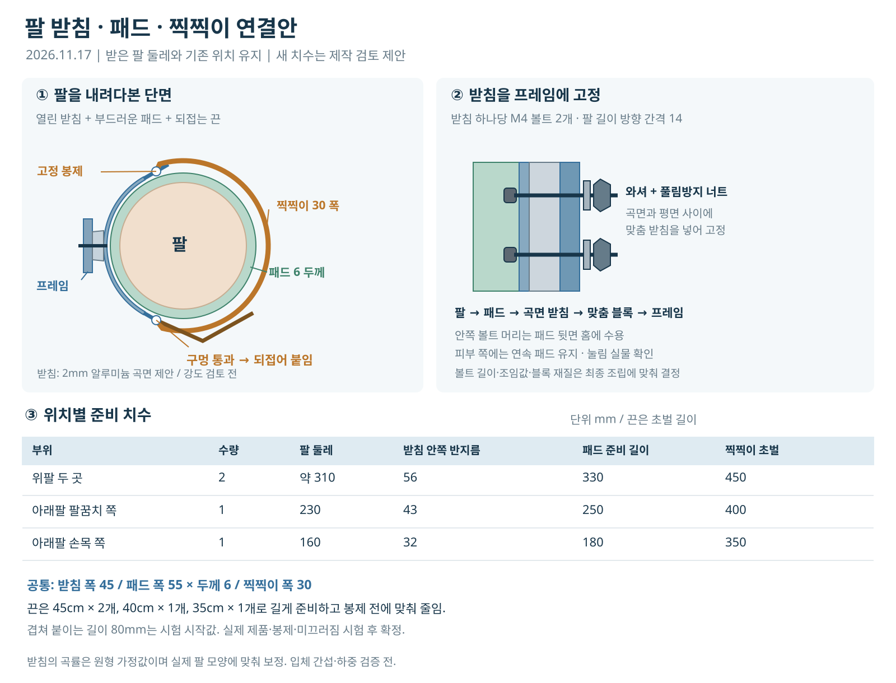
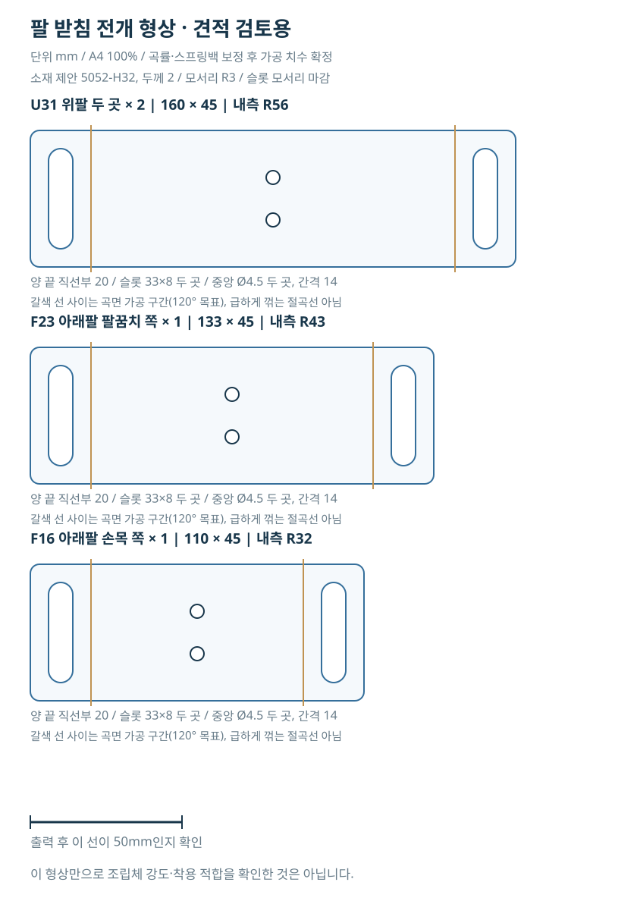

# 팔 받침·패드·찍찍이 상세 검토안

> **2026-11-18 자체 검토: 가공·최종 봉제 보류.** 아래팔 연결 높이, 테이퍼, 작은 받침의 찍찍이 길이를 수정해야 한다. 아래에서 철회한 값은 제작 기본값으로 쓰지 않는다. [검토 결과와 계산](CUFF_SELF_REVIEW.md)

작성일 2026-11-17. [현재 설계 기준](../PROJECT_STATE.md)과 [프레임·관절안](FRAME_JOINT_DRAFT_2026-11-16.md)을 따른다.

**이번 결과물은 연결 구조·치수·견적 범위를 구체화한 검토안이다.** 아래 반지름·소재·가공 형상·봉제 길이는 새 제안이며 발주 확정이나 동력 착용 허용을 뜻하지 않는다. 사용자 제공 팔 둘레와 종이 모형에서 걸림·불편 없었다는 보고를 설계 입력으로 사용했다.

## 1. 만들 구조

팔 안쪽부터 **천 커버를 씌운 패드 → 열린 곡면 받침 → 곡면과 평면을 맞추는 블록 → 기존 프레임** 순서다. 받침 하나를 M4 볼트 두 개로 프레임에 고정한다. 받침 양 끝의 둥근 슬롯에 폭 30mm 끈을 연결한다. 한쪽은 되접어 봉제하고, 반대쪽은 구멍에 끼운 뒤 되접어 찍찍이로 붙여 조절한다.

- 받침은 **5052-H32 알루미늄 판 두께 2mm, 팔 길이 방향 폭 45mm, 곡면 120°**를 우선 검토한다. 제조사가 제공한 냉간 성형 자료를 참고한 소재 제안이며, 실제 받침 강도·성형 공정·가격은 별도 확인한다. [1]
- 피부와 금속 사이에는 **두께 6mm, 폭 55mm의 폐쇄기포 PE 폼과 부드러운 교체형 천 커버**를 제안한다. 폼은 팔을 둘러 받침과 끈 아래를 모두 덮는다. 실제 제품의 눌림·마찰·세척·피부 접촉 적합성을 확인한다. 참고 재료인 LD45의 자료도 대표 물성 안내이며 이 용도의 적합성 보증이 아니다. [2]
- 끈은 **폭 30mm, 늘어남이 적은 웨빙 + 봉제형 훅/루프**를 제안한다. 표면 접착만으로 끈을 고정하지 않는다. 천에 붙이는 훅/루프의 네 변을 봉제하는 제조사 안내를 참고하고, 실제 봉제부·슬롯·닫힘부의 하중을 함께 검증한다. [3]
- 열린 쪽에서 끈을 풀어 탈착한다. 잡아당길 끝단 20mm는 훅을 붙이지 않은 탭으로 남기고 쉽게 잡히는 위치에 둔다. 손을 가린 채 찾거나 벨트 근처로 손을 넣어야 하는 위치는 피한다. 실제 탈착 시간과 조작 가능 여부는 검증 전이다.
- 모터 위치 147.5mm, 기존 위팔/아래팔 프레임 배치, 모터측 3D 프린팅 일체형 직접 체결 풀리는 그대로다. **이번 알루미늄 제안은 팔 받침의 소재**다.

## 2. 위치와 치수

모든 표의 치수 단위는 mm다. 둘레의 mm 표시는 사용자 값을 환산한 것이며 1mm 정밀도로 측정했다는 뜻은 아니다.

| 코드·수량 | 팔꿈치 기준 중심 위치 | 팔 둘레 | 받침 안쪽 반지름 제안 | 금속판 준비 크기 | 패드 준비 크기 | 끈 초벌 길이 |
|---|---|---:|---:|---|---|---:|
| U31 ×2 | 어깨 방향 80 / 205 | 각 약 310 | 56 | 160 × 45 × 2 | 330 × 55 × 6, 두 장 | 450, 두 개 |
| F23 ×1 | 손목 방향 70 | 230 | 43 | 133 × 45 × 2 | 250 × 55 × 6 | 400 |
| F16 ×1 | 손목 방향 180 | 160 | 32 | 110 × 45 × 2 | 180 × 55 × 6 | 350 |

**팔 둘레만으로 실제 팔 단면은 알 수 없다.** 이번 반지름은 원형 단면과 눌리지 않은 6mm 패드를 가정한 `R = 둘레/(2π) + 6`에서 각각 55.34 / 42.61 / 31.46mm를 얻고, 첫 형상 검토용으로 56 / 43 / 32mm로 올림한 값이다. 실제 팔의 타원형·테이퍼·근육 변화에 맞춰 열린 곡면을 보정한다. 이 반지름대로 만들면 반드시 맞는다고 판정하지 않는다.

판을 120° 곡면으로 만들고 양 끝에 직선부 20mm씩을 남기는 안이다. 중립면을 판 두께 중앙으로 가정하면 전개 길이는 `40 + (R+1)×2π/3`이며 약 159.4 / 132.2 / 109.1mm다. 위 준비 크기는 이를 올림했다. 스프링백·전개 여유·실제 가공법을 업체와 맞춘 뒤 최종 형상을 정한다. 표시된 곡면 구간 경계는 날카롭게 꺾는 선이 아니다.

패드 준비 길이는 6mm 두께의 중간면을 기준으로 `둘레 + 2π×3`을 적용한 약 328.8 / 248.8 / 178.8mm에 여유를 둔 것이다. 커버 두께·눌림을 반영하여 끝단이 뭉치거나 겹쳐 두꺼워지지 않도록 조정한다. 임의로 압박을 더 주어 치수를 맞추지 않는다.

위팔 U31 받침은 각각 폭 45mm이므로 어깨 쪽 받침 범위가 관절 위 182.5~227.5mm다. 기존 프레임 끝 220mm를 7.5mm 넘어서는 받침 자체의 돌출이 있다. 패드는 177.5~232.5mm 범위다. 어깨 기준점 260mm까지의 여유는 남지만, 모터 장착판의 끝과 축 방향 위치가 겹칠 수 있으므로 **종이 모형의 확인 결과를 그대로 확대 적용하지 않고 입체로 대조**한다.

## 3. 받침과 프레임 체결

- 슬롯: 양 끝 직선부 중앙에 **33 × 8mm 캡슐 모양** 두 곳. 끈 폭 30mm와 실제 봉제 두께가 통과하는지 확인한다. 슬롯의 길이 방향은 팔 길이 방향이다. 구멍 끝과 판 끝 사이 최소 명목 여유는 6mm다. 둥근 끝만 만들고 절단면을 날카롭게 두면 끈이 손상될 수 있어 슬롯 안쪽까지 매끈하게 마감한다.
- 바깥 윤곽: 전개도 모서리 R3 제안. 성형 뒤 전체 모서리·버·슬롯 안쪽을 마감하고 천 커버/패드로 피부 접촉면을 분리한다.
- 프레임 체결: 받침 중앙에 **Ø4.5 구멍 두 개**, 팔 길이 방향 간격 **14mm**, 곡면의 중심선에 배치한다. 기존 프레임에도 대응 위치의 관통 구멍이 필요하다. 프레임의 다른 홀·모터판·벨트·관절 지지대와 대조한 후 뚫는다.
- 위팔 어깨 쪽 중심 205mm의 볼트 중심은 198/212mm다. 프레임 끝 220mm까지 가까운 홀의 중심 거리는 8mm로 계산된다. 이 여유 계산은 체결 강도 확인이 아니다. 프레임 폭 30mm와 아래팔 폭 25mm는 기존 검토값을 유지한다.
- 받침과 평평한 프레임 사이에는 곡면 맞춤 블록을 둔다. **중앙 두께 3mm를 네 곳에 공통 적용했던 제안은 철회한다.** 아래팔 두 받침은 같은 팔 중심선 가정에서 프레임 연결면 높이가 11mm 다르므로, 관절 허브와 프레임의 위치·각도를 정한 뒤 블록별 높이를 설계한다. 원래 제안한 길이 28mm·폭 30/25mm와 가장자리 두께 계산도 완성 치수가 아니다. PETG 출력물은 무부하 맞춤 모형에 검토할 수 있으나 동력용 재질·크리프·체결력은 별도 확인한다.
- 체결 상세는 재검토한다. **볼트 머리를 패드 홈에 넣고 피부 쪽 패드 2mm를 남긴다는 기존 기준은 철회한다.** 피부 쪽 단단한 돌출을 줄이는 구조와 하중 분산을 우선 검토한다. 안쪽 머리·분산판을 유지한다면 실제 부품 높이와 눌린 패드 두께·압박을 확인한 뒤 설계한다. 6mm 패드만으로 체결부를 수용할 수 있다고 가정하지 않는다.
- 볼트는 전체 8개, 후보 직경 M4다. 길이는 실제 받침·블록·프레임·분산판·와셔·너트 두께와 체결 여유를 합산해 정한다. 현재 길이·등급·조임 토크는 발주 확정 전이다. 튀어나온 끝이 벨트·피부·옷에 닿지 않도록 조립을 대조한다.

모터의 힘은 프레임 → 볼트/블록 → 받침 → 패드/끈 → 팔로 전달된다. 곡면 받침이나 패드의 접착제가 이 전체 하중을 받는 구조로 취급하지 않는다.

## 4. 찍찍이 제작과 길이 계산

**초벌 웨빙 길이는 U31 450mm ×2, F23 400mm ×1, F16 350mm ×1**로 합계 1,650mm다. 아직 최종 봉제·완성 길이가 아니다. 2m를 견적 요청 기준으로 잡으면 절단·봉제 조정 여유가 350mm 남는다.

1. 한쪽 슬롯으로 끈을 넣어 **약 35mm 되접은 고정부**를 만든다. 실제 소재에 맞는 봉제 방식·실·박음질로 고정한다. 단순 접착 또는 봉제 두 줄만으로 하중 성능을 가정하지 않는다.
2. 끈이 패드 바깥쪽의 열린 구간을 돌아 반대쪽 슬롯을 통과하게 한다. 끈과 EMG 전극·케이블이 겹치지 않도록 위치를 잡는다.
3. 자유단을 되접어 바깥쪽 면끼리 붙인다. **루프 30×150mm를 네 곳의 공통 완성 길이로 쓰던 제안은 철회한다.** 원형 단면·슬롯 중심 경로 근사에서 손목 쪽 주 경로는 약 115mm라 기존 150mm 패치보다 짧다. 루프 길이와 위치는 각 끈의 실제 경로·봉제 여유·필요 겹침·조절 범위를 함께 반영해 정한다. 훅 80mm는 검증 전 시험 제안이며, 작은 받침을 맞추려고 겹침을 임의로 줄이지 않는다. 훅과 루프는 되접었을 때 마주 보도록 봉제하고 피부로 향하지 않게 한다.
4. 실제 슬롯 위치와 패드 두께를 반영해 되접는 지점과 패치 위치를 표시한 뒤 봉제한다. 끝의 20mm는 잡아당기는 탭으로 남긴다. 남는 끈은 움직이는 벨트로 들어가지 않도록 정리한다.
5. **80mm 겹침은 강도가 보장된 최소치가 아니다.** 제품별 박리·전단 성능, 반복 사용, 먼지·땀, 봉제부와 끈 경로에 따라 확인해야 한다. 제조사는 힘의 방향에 따라 박리·전단·인장 성능을 나누어 설명한다. [4]

초벌 길이 산정의 확인용 근사는 `열린 경로 = (팔 둘레 + 2π×패드6mm)×2/3 + 슬롯/경로 여유40mm`다. 여기에 고정부 35mm, 접착 구간 80mm, 탭 20mm를 더하면 약 407 / 354 / 307mm가 된다. 초벌 450 / 400 / 350mm는 이 근사보다 길게 준비하는 값이다. **실물 경로를 잰 최종 값이 아니며**, 남는 여유로 봉제 위치를 조정한다. 이 산식은 재료량 여유용으로, 루프 패치를 붙일 수 있는 실제 주 경로 길이를 뜻하지 않는다. [자체 검토의 별도 경로 계산](CUFF_SELF_REVIEW.md#2-찍찍이의-재료-준비-길이와-붙일-수-있는-길이는-다르다)을 기준으로 위치별 패치 배치를 다시 정한다.

## 5. 견적 요청할 묶음

| 묶음 | 수량·치수 제안 | 업체에 포함해 달라고 할 것 |
|---|---|---|
| 알루미늄 곡면 받침 | U31 2개 + F23 1개 + F16 1개 | 5052-H32 2mm 판, 절단·슬롯/홀·곡면 성형·스프링백 보정·모서리와 슬롯 마감 |
| 곡면 맞춤 블록 | 4개, 위팔용 2개/아래팔용 크기별 1개 | 위치별 높이·각도 보정 후 형상 맞춤용 출력과 동력용 가공안을 구분 |
| 패드와 천 커버 | 330×55×6 두 개, 250×55×6 한 개, 180×55×6 한 개 | 커버와 마감. 체결 구조 재검토 후 홈 여부 결정. 접착은 패드 위치 고정용 |
| 비탄성 웨빙 | 폭 30mm, 총 2m 견적 기준 | 같은 폭의 가장자리가 마감된 제품, 봉제 가능 여부 |
| 봉제형 루프 | 폭 30mm, 약 1m 견적 기준 | 미재단 원자재 여유량. 네 조각의 완성 길이는 미정이며 호환 훅과 한 쌍으로 선정 |
| 봉제형 훅 | 폭 30mm, 약 0.5m 견적 기준 | 80mm 네 조각 + 여유 |
| 봉제 작업 | 끈 4개 | 고정부, 훅/루프 네 변 봉제, 풀탭. 실제 샘플로 하중 확인 |
| 체결류 | M4 볼트/너트 각 8개 + 와셔·분산판 | 길이·등급은 조립 치수 확정 뒤 지정 |

**실제 가격·재고·납기는 아직 받지 않았다.** 기존 계획 소계 490,967원, 총 한도 774,000원, 남은 283,033원은 그대로다. 이 잔액은 팔 받침뿐 아니라 프레임·구동 기구·전원 보호·배선·배송을 모두 포함해야 한다. 이번 품목을 구매 완료 목록이나 확정 가격으로 기존 엑셀에 더하지 않는다.

형상이 바뀔 수 있으므로 확정 치수 견적·가공 발주는 보류한다. 공개 저장소의 자료로 대략적인 공정·가격 상담 준비는 가능하지만 아직 업체에 요청·메시지 전송·발주하지 않았다. 거래 업체에는 기존 대회 구매 절차의 견적·날인·거래명세서·세금계산서 요건을 적용한다.

## 6. 파일과 검증 범위

- [연결 그림](CUFF_STRAP_OVERVIEW_2026-11-17.svg)
- [A4 전개 형상 검토표](CUFF_FLAT_REVIEW_2026-11-17.svg): mm 크기 지정, 100% 인쇄용 50mm 확인선 포함. 추가 착용 시험을 마쳤다는 뜻이 아니다.
- [U31 전개 DXF](cuff/CUFF_U31_REVIEW.dxf), [F23 전개 DXF](cuff/CUFF_F23_REVIEW.dxf), [F16 전개 DXF](cuff/CUFF_F16_REVIEW.dxf): mm, 견적·형상 검토용. `CUT_REVIEW`는 윤곽/구멍, `FORM_REFERENCE`는 곡면 구간의 참고 경계다. **참고선을 절단하지 않는다.** 원호 모서리는 미세 선분으로 표현했다. 테이퍼·연결 높이·끈 경로 보정 전 최종 가공 파일로 사용하지 않는다. `REVIEW_NOTE`의 가공 보류 문구는 안내용이며 절단선이 아니다.
- [치수 매개변수](cuff/CUFF_PARAMETERS_2026-11-17.json): 사용자 둘레와 제안 치수·계산값을 구분해 기록한다.

**기존 검사는 조립 적합 검사가 아니었다.** 확인한 것은 cm→mm 환산, 준비 길이 산식, 구멍/슬롯 위치와 명목 여유, SVG/DXF 형상 및 그림의 표시 상태다. DXF 3개는 CAD 파일 판독기로 다시 열어 단위·외곽 크기·홀 개수/지름/간격과 파일 구조 검사를 수행했다. 받침·끈·체결부의 강도, 팔 단면 적합, 피부 압박, EMG 전극 간섭, 하중 시 미끄러짐, 빠른 탈착, 모터 장착 후 입체 간섭은 실물 검증 전이다.

다음 기구 작업은 **이 받침과 모터·벨트·관절부를 함께 놓은 입체 조립 배치**에서 돌출과 간섭을 확인하는 것이다. 그 결과로 블록 형상·볼트 길이·가공 도면을 확정하고 견적을 맞춘다. 하중 시험은 더미팔에서 진행하며 종이 모형에서 걸림 없었던 결과를 동력 착용 적합 판정으로 사용하지 않는다.

## 참고한 제조사 자료

1. [Hulamin 5052 판재 자료](https://www.hulamin.com/sites/default/files/downloads/5052%20Data%20Sheet.pdf): 5052-H32 판재의 성형 및 물성 정보. 2mm 받침의 완성품 강도를 인증하는 자료는 아니다.
2. [Zotefoams Plastazote LD45 자료](https://zotefoams.com/wp-content/uploads/2025/03/LD45-December-2017.pdf): 폐쇄기포 가교 PE 폼의 대표 압축·재료 물성. LD45로 최종 구매 확정한 것이 아니다.
3. [VELCRO 제조사 봉제 안내](https://www.velcro.com/news-and-blog/2023/09/mastering-how-to-sew-with-velcro-brand-fasteners-a-quick-guide/): 훅/루프 네 변 봉제 등 부착 방법 참고. 이번 로봇의 봉제 하중은 따로 확인한다.
4. [VELCRO 제조사 힘 방향 설명](https://www.velcro.com/news-and-blog/2023/02/how-do-velcro-brand-fasteners-work/): 박리·전단·인장 방향의 차이. 특정 제품 수치를 우리 끈의 허용 하중으로 옮기지 않았다.

