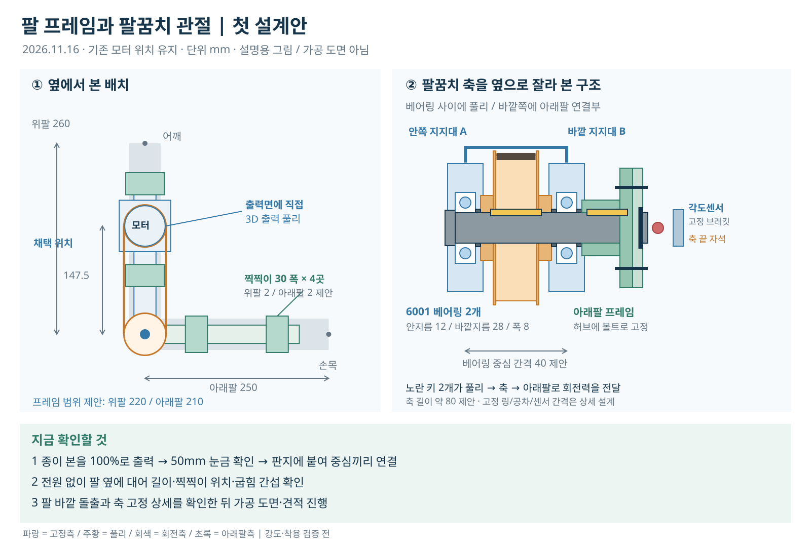

# 프레임·팔꿈치 관절 첫 설계안

작성일: 2026-11-16. [현재 설계 기준](../PROJECT_STATE.md)을 따른다.

**목적은 부품 사이의 연결 구조와 필요한 공간을 정하는 것이다.** 이 문서의 새 치수는 설계 제안이다. 가공용 CAD·구멍 공차·강도 검증·구매 승인이 완료된 도면이 아니다. 사용자가 채택한 상완 모터 → 벨트 → 독립 회전 관절축 → 전완 프레임 구조와 모터측 일체형 3D 출력 풀리는 유지한다.

## 1. 정해진 기준과 이번 제안

| 항목 | 값 | 근거·상태 |
|---|---|---|
| 위팔·아래팔 길이 | 260 / 250mm | 사용자 제공. 측정 자세·기준점은 실물 대조 필요 |
| 모터 중심 | 팔꿈치 축에서 어깨 방향 147.5mm | 11월 16일 사용자 채택 |
| 팔 굵기 조절 | 패드·커프와 찍찍이 | 사용자 채택. 프레임 길이 조절 기능은 추가하지 않음 |
| 위팔 프레임 범위 | 관절 중심에서 어깨 방향 220mm | 이번 제안. 어깨 기준점까지 40mm 남김. 관절 원형부는 중심 반대편으로도 돌출 |
| 아래팔 프레임 범위 | 관절 중심에서 손목 방향 210mm | 이번 제안. 손목 기준점까지 40mm 남김 |
| 주 프레임 재료·단면 | 6061-T6 알루미늄 검토, 위팔 폭 30 × 두께 4mm / 아래팔 폭 25 × 두께 4mm | 초기 공간·가공 검토값. 구멍·측면 휨·비틀림·피로를 포함한 강도 계산 전 |
| 모터 장착판 자리 | 약 70 × 70mm | Ø55mm 몸체 주변 공간 검토. 실제 고정부·볼트 접근은 공식 도면에 맞춰 별도 설계 |
| 찍찍이 | 폭 30mm, 위팔 2개·아래팔 2개 | 이번 제안. 위팔 중심은 관절 위 80 / 205mm, 아래팔은 관절 아래 70 / 180mm |
| 패드·커프 | 팔 형태에 맞는 받침에 찍찍이 연결 | 팔 둘레·착용 간격 실측 후 곡면·끈 길이 확정. 평판 모서리를 피부에 직접 대는 구조로 제작하지 않음 |
| 관절 회전축 | 공칭 Ø12mm 강재, 약 80mm 축 방향 공간 | 이번 제안. 재질 등급·축 공차·홈·고정 링 상세 미정 |
| 관절 베어링 | 6001 계열 2개, 12 × 28 × 8mm | NSK 공개 치수와 대조. 실드/씰 형식·내부 틈새·제조사 선정 전 [1] |
| 베어링 중심 간격 | 40mm | 이번 제안. 두 베어링 안쪽 면 사이 32mm |
| 관절 풀리 | HTD5M 36T, Ø12 키홈 허브를 갖는 알루미늄 검토 | 제품번호·납기·가공비 미확정. 축 방향 전체 폭 28mm 이하 공간 예약 |
| 벨트 폭 | 15mm를 넣을 공간을 먼저 예약 | 구매 규격 확정 아님. 제조사 허용 전달력·장력·풀리 치형을 확인한 뒤 결정 |

## 2. 무엇을 어디에 고정하나

**고정되는 부분:** 위팔 프레임, 모터 몸체, 베어링 지지대 A·B, 각도 센서 기판.

**같이 회전하는 부분:** 관절 풀리 → 금속 키 → 금속 축 → 두 번째 키 → 아래팔 연결 허브 → 볼트로 연결된 아래팔 프레임. 베어링 안쪽 링은 축과 함께 회전하고 바깥 링은 지지대에 지지된다.

키는 축과 풀리 구멍에 함께 끼우는 작은 금속 막대다. 축과 허브가 서로 헛도는 것을 막는다. **관절축은 고정된 볼트가 아니라 돌아가는 축**이다. 베어링은 축을 받치는 부품이며, 프레임으로 토크를 전달하는 키·허브를 대신하지 않는다.

- 두 지지대 사이에 관절 풀리를 놓아 벨트 하중을 양쪽에서 받는다. 바깥 지지대 B는 분해 가능한 볼트 체결 구조로 한다.
- 지지대 연결부는 벨트 경로 및 아래팔 프레임의 회전 범위 밖으로 우회한다. 그림의 위쪽 연결선은 연결 관계 표시이며 실제 브리지 위치·치수는 아니다.
- 아래팔 연결 허브는 **관절측 부품**이다. 사용자가 제외한 모터측 별도 금속 어댑터를 다시 도입하는 것이 아니다. 모터측 풀리는 출력 플랜지에 직접 고정하는 일체형 출력물로 유지한다.
- 관절측 풀리는 키홈을 가진 금속 허브가 일체화된 제품/가공품을 우선 검토한다. 둥근 구멍만 있는 풀리나 작은 고정나사 하나만으로 토크 체결이 끝났다고 보지 않는다.
- Ø12mm 축의 키 단면은 DIN 6885-1 계열 **4 × 4mm**를 검토한다. 길이는 풀리측 약 20mm, 출력 허브측 약 16mm 공간을 예약하되 유효 접촉 길이·압력·축 홈 응력 집중 계산 후 확정한다. [2]
- 출력 허브는 축 방향 20mm 안에 플랜지를 포함하는 안이다. 아래팔 연결은 4개 볼트를 쓰는 배치를 검토하며, 원형부 약 Ø50mm 자리 안에 볼트 간격·접근·너트 고정·풀림 방지를 상세 설계한다. 아직 볼트 구멍 가공 치수는 발행하지 않는다.

## 3. 관절축 방향 공간 배분

다음 z는 **베어링 A의 안쪽 면을 0**으로 하는 조립 좌표다. 피부면 또는 모터 고정면을 뜻하지 않는다. 숫자는 공간 배분용이며 가공 공차가 아니다.

| z 범위(mm) | 부품·기능 |
|---|---|
| −4 ~ 0 | 축 어깨 자리. A 안쪽 링 지지용. 어깨 외경·모서리 반경은 선정 베어링 허용치에 맞춤 |
| 0 ~ 8 | 베어링 A |
| 8 ~ 10 | 회전부 스페이서 공간 |
| 10 ~ 38 | 관절 풀리·키 허브 전체 폭 예약 28 |
| 38 ~ 40 | 회전부 스페이서 공간 |
| 40 ~ 48 | 베어링 B |
| 48 ~ 50 | 회전부 스페이서 공간 |
| 50 ~ 70 | 아래팔 연결용 키 허브·플랜지 |
| 70 ~ 72 | 와셔/시임 공간 |
| 72 ~ 76 | 축 고정 링·끝단 공간. 실제 홈 폭·위치는 규격 선정 후 작성 |
| 축 끝 바깥 | 자석 홀더와 고정 AS5600 브래킷. 자기장·편심·간격 확인 후 배치 |

베어링 중심은 z=4와 z=44로 간격 40mm다. 풀리 예약폭 28mm와 양옆 2mm씩의 공간은 안쪽 면 간격 32mm에 들어간다. 이 계산은 **공간의 합만 확인**한 것이다. 2mm는 하중용 스페이서 자리이므로 벨트 플랜지나 고정 하우징이 어느 방향으로 돌출해도 된다는 뜻이 아니다.

축 어깨·스페이서·허브·고정 링은 회전부와 안쪽 링의 축 방향 위치를 잡는다. 스페이서가 실드·씰·바깥 링에 닿지 않게 한다. A 바깥 링은 하우징 어깨와 덮개로 위치를 잡고, B 바깥 링은 조립 오차/열팽창을 흡수할 축 방향 이동을 허용하는 안을 검토한다. **정확한 끼워맞춤·동심도·유격은 미정**이다. 두 지지대 볼트를 무조건 세게 조여 베어링 안팎 링을 함께 압박하지 않는다.

위팔 프레임 두께 4mm만으로 폭 8mm 베어링을 지지할 수 없다. 별도 금속 베어링 블록과 체결판이 필요하다. 출력물에 베어링을 억지로 끼운 구조를 동력시험용 지지대로 확정하지 않는다.

**팔 바깥 돌출이 이번 안의 중요한 검토 항목이다.** 관절축 조립부에만 약 80mm가 필요하고, 모터의 축 방향 길이는 공식 도면상 56.5mm다. [3] 모터 출력 풀리와 관절 풀리의 벨트 중심면을 일치시키면서 몸체·프레임·커프·센서를 배치해야 한다. 따라서 80mm를 최종 피부면부터의 돌출값으로 사용하면 안 된다. 모터 장착 방향과 출력 풀리 높이를 반영한 입체 배치 후 최종 돌출을 계산한다. 불편하거나 간섭하면 **147.5mm의 세로 위치는 유지하면서** 지지대 간격·허브 폭·횡방향 배치를 먼저 재검토한다.

## 4. 벨트·강도에 대한 계산 확인

36T/36T, 피치 5mm라는 기존 우선 검토안에서는 피치 지름이 `36×5/π = 57.30mm`이고, 같은 크기 풀리의 피치 길이는 `2×147.5 + 36×5 = 475mm`, 95톱니다. 이 수치는 벨트 제품의 치형·폭·허용 장력·납기를 확인한 구매 승인이 아니다. HTD5M과 다른 5mm 피치 치형을 혼용하지 않는다.

장력 조절은 **모터 장착판 전체를 위팔 방향으로 미세 이동**시키는 구조를 우선 검토한다. 모터 출력 플랜지의 구멍을 늘리거나 관절 위치를 바꾸지 않는다. 147.5mm가 설계 기준점이며 조립·장력 설정용 이동량은 벨트 제조사 기준으로 정한다. 허용 이동 범위·나사 위치·잠금 구조는 아직 미확정이다.

| 계산 | 결과 | 해석 한계 |
|---|---:|---|
| 8Nm / 피치 반지름 28.65mm | 벨트 양쪽 장력 차 약 279N | 실제 축에 작용하는 힘은 장력 차가 아니라 양쪽 장력과 초기 장력의 영향까지 포함 |
| 원형 Ø12 축의 명목 비틀림 `16T/(πd³)` | 8Nm에서 23.6MPa, 24Nm에서 70.7MPa | 키홈·굽힘·응력 집중·피로·재질을 제외한 값. 안전율이나 사용 허용 판정 아님 |
| 베어링 안쪽 공간 | 40 − 8 = 32mm | 28mm 풀리 예약폭 + 2mm × 2, 공차 포함 전 |
| 어깨·손목 기준점까지 평면 여유 | 각각 40mm | 팔 둘레·연부조직·입체 돌출 및 실제 굽힘 간섭 미반영 |

관절 베어링 두 개를 넣어도 **모터 출력부에 걸리는 벨트 측하중은 사라지지 않는다.** 모터 출력부, 출력 풀리의 층간 파손·볼트 주변 압력, 관절축·키·허브, 프레임·지지대의 복합 하중을 각각 확인한다. 정격 8Nm 또는 최대 24Nm를 이 초안 전체가 견딘다고 판정하지 않는다. 기계식 스토퍼의 충격 하중도 별도로 고려한다.

## 5. 조립 순서와 가공 전 남은 상세

1. 위팔 프레임·지지대 A를 조립하고 축·베어링 A를 배치한다. 끼워맞춤에 따른 조립 순서와 가압 방향은 최종 선정 베어링 지침에 맞춘다.
2. 스페이서, 풀리용 키와 관절 풀리, 스페이서, 베어링 B와 분리형 지지대 B를 순서대로 배치한다. 베어링 좌면에는 키홈을 두지 않도록 축을 구간별 설계한다.
3. 출력측 키·허브·와셔·고정 링을 조립하고 아래팔 프레임을 플랜지에 체결한다. 손으로 돌려 걸림·유격을 확인한다.
4. 모터 몸체는 고정판에, 출력 풀리는 회전 출력면에 체결한다. 두 풀리 중심면을 맞추고 벨트 장력을 설정한다. 모터 볼트 길이는 실제 출력물/와셔 두께와 제조사 나사 깊이를 대조해 정하며 바닥에 닿지 않도록 한다. [3]
5. 축 끝의 자석과 고정 센서를 정렬한다. 철제 축 끝이 자석의 자기장에 미치는 영향까지 실물 확인한다.
6. 프레임에 하중이 전달되는 기계식 스토퍼, 벨트·관절 덮개, 커프·패드·빠른 탈착을 설계한다. 센서 기판이나 벨트 덮개를 스토퍼로 쓰지 않는다.

가공용으로 남은 것은 **축 재질·공차·홈/고정 링, 베어링 블록과 프레임 체결, 풀리 치형·폭과 키 허브, 모터판/장력 조절, 스토퍼·가드·커프의 입체 도면**이다. 이 상세가 없는 상태에서 본 문서와 종이 본만으로 금속 가공·동력 사용을 발주하지 않는다.

## 6. 지금 할 수 있는 확인과 예산

[A4 배치 확인용 PDF 2장](FRAME_FIT_TEMPLATES_2026-11-16.pdf)을 **실제 크기 100%**로 인쇄한다. 자동 페이지 맞춤을 끄고 각 장의 50mm 눈금을 자로 확인한다. 색이 채워진 프레임 외곽을 판지로 옮기고 두 관절 중심을 연결한다. 빈 초록 사각형은 찍찍이 자리다. 가위·핀 작업은 팔에서 떨어진 곳에서 하고, 전기 부품이나 추를 달지 않은 본을 팔 옆에 대어 길이와 굽힘 간섭을 확인한다.

다음에 필요한 사용자 실측은 **찍찍이 후보 위치의 위팔·아래팔 둘레**다. 각각 두 곳의 둘레와 편안한 끈 위치를 받으면 커프 곡면·패드 두께·끈 길이를 구체화할 수 있다. 종이 본은 이 둘레나 입체 돌출을 검증하지 않는다.

새로 견적이 필요한 기구 묶음은 베어링 2개, 가공 강재 축 1개, 키 2개, 관절 풀리 1개, 아래팔 연결 허브 1개, 베어링 블록/지지대, 프레임·모터판, 벨트 1개, 고정 링·스페이서·체결류, 모터 풀리 출력, 패드·찍찍이, 스토퍼·가드다. **기구 비용은 아직 산출하지 않았다.** 기존 부품 계획액 490,967원에 포함됐다고 처리하지 않는다. 남은 283,033원에서 기구뿐 아니라 전원 보호·배선·배송까지 충당해야 하므로 가공 견적과 함께 전체 예산을 다시 합산한다.

먼저 전원 없는 모형으로 치수를 확인하고, 상세 도면과 견적을 마련한 뒤 더미팔 동력 시험으로 넘어간다. 사람을 착용시킨 동력 시험은 별도의 전문가 검토·보호 조건 확인 후 진행한다.

## 확인한 자료

1. [NSK 6001 공식 치수](https://www.nsk.com/engineering/products/bearings/ball-bearings/deep-groove-ball-bearings/6001-apn.html): d=12, D=28, B=8mm. 이 표준 치수는 전체 구조의 하중 적합 판정과 별개다.
2. [Elesa+Ganter DIN 6885 키홈 기술표](https://www.elesa-ganter.com/static/technicaldata/files/DIN6885_Keyways_EN.pdf): DIN 6885/1의 10mm 초과~12mm 축 구간에서 키 단면 4×4mm. 길이·재질·허용 토크는 이번 설계에서 별도 검토한다.
3. [CubeMars AK45-36 V3.0 공식 2D 도면](https://www.cubemars.com/data/cms/202607/ak45-36-v3-0-kv80-2d-drawing.pdf): 몸체와 체결면 치수 확인용. 모터측 직접 체결 풀리의 나사 위치·깊이는 이 도면 및 수령품을 기준으로 검증한다.

도면·PDF의 배치와 위 계산은 이 프로젝트를 위한 자체 제안이며, 제조사의 완성 조립 설계를 복제하거나 승인받은 것이 아니다.
