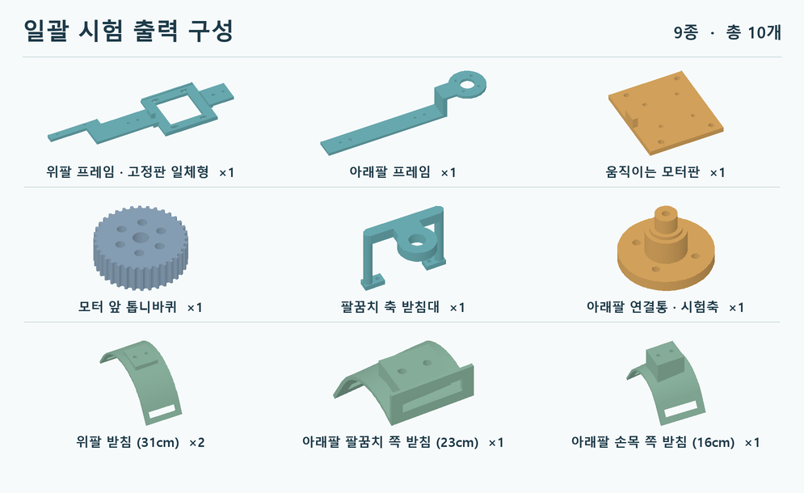

# 한 번에 출력하는 팔꿈치 모형

2026-11-21 · 팔꿈치 위치, 찍찍이 조절 범위, 모터 체결을 실물 크기로 확인하는 무동력 시험용

현재 착용형 시제품의 도면과 수량은 [11월 25일 출력 검토](../wearable_joint/3D출력_검토.md)에서 확인한다. 아래는 11월 21일 모형의 견적 기록이다.

## 출력 견적

[업체 전달용 ZIP](팔꿈치로봇_일괄시험출력.zip)을 풀면 **STL 9종과 수량표**가 나온다. 위팔 받침 U31은 2개, 나머지는 각 1개로 **총 10개**다. 기존에 올린 모터 톱니바퀴와 움직이는 모터판도 포함했다. 종전의 짧은 고정판과 슬라이드 받침판은 통합 위팔 프레임 한 개로 대체한다.

| 한 번에 뽑을 것 | 수량 | 확인할 내용 |
|---|---:|---|
| 위팔 프레임, 아래팔 프레임 | 각 1 | 팔 길이와 팔꿈치 중심, 굽힐 때 두 프레임의 여유 |
| 위팔 받침 U31, 아래팔 받침 F23·F16 | 2 + 1 + 1 | 위팔 두 곳과 팔꿈치·손목 쪽 둘레, 패드와 끈을 댈 자리 |
| 모터 앞 톱니바퀴, 움직이는 모터판 | 각 1 | 수령한 모터 앞뒤 나사 위치와 슬라이드 이동 |
| 팔꿈치 축 받침대, 시험축이 달린 아래팔 연결통 | 각 1 | 베어링이나 가공 축을 기다리는 동안 손으로 굽히는 조립 시험 |

온라인 견적에는 ZIP에서 꺼낸 STL만 올리고 U31 수량을 2로 바꾼다. 비고는 [수량표·견적 요청](print/출력_수량표_견적요청.txt)에 있다. 모두 PETG·FDM·실제 크기 100%, 내부 채움 25% 기준이다. 배송비와 부가세를 포함한 총액과 수령일을 확인한 뒤 사업단 구매 절차로 진행한다. 이전 11,000원은 모터 톱니바퀴 1개만 올렸을 때의 화면 견적이다.

## 출력물이 오면

1. **팔 받침부터 구분한다.** U31 두 개는 위팔에, F23은 아래팔 팔꿈치 쪽에, F16은 손목 쪽에 둔다. 곡면 안쪽이 팔을 향하고 평평한 면이 각 프레임에 닿는다. 각 받침을 두 구멍으로 고정한다.
2. **두 프레임을 연결한다.** 위팔 프레임의 팔꿈치 끝에 다리 두 개 달린 축 받침대를 M3 두 개로 붙인다. 아래팔 프레임의 둥근 끝에는 시험축이 달린 연결통을 M4 네 개로 고정한다. 길게 나온 시험축이 팔 바깥을 향한다.
3. **회전을 확인한다.** 시험축을 받침대의 큰 구멍에 끼운다. 아래팔 쪽에서 중심 M4 볼트를 통과시키고 반대쪽에 큰 와셔와 너트를 끼운다. 와셔는 돌출한 시험축 끝에 닿고 받침대와 약 0.8mm 떨어지는 설계다. 와셔가 받침대를 눌러 움직임을 막거나 축이 쉽게 빠지면 조립 상태를 다시 확인한다. 탁자에서 두 프레임을 손으로 굽힌다.
4. **팔에는 가벼운 모형으로 위치를 대조한다.** 안쪽 곡면과 체결부를 부드러운 패드로 덮고 찍찍이를 건다. 모터·배터리·추를 뺀 채 팔꿈치 중심, 뼈 주변 눌림과 끈 위치를 살핀다. CAD의 회전 범위는 모형끼리의 검사 범위다.
5. **모터는 탁자에서 별도로 맞춘다.** 위팔 프레임의 넓은 자리 위에 움직이는 판을 놓고 가이드 사이로 가볍게 움직여 본다. 전원을 끈 실제 모터를 대고 뒤쪽 나사 4곳과 앞쪽 톱니바퀴 나사 6곳을 대조한다. 프레임 모형의 매끈한 시험축은 손 조립에 사용한다. 벨트로 아래팔에 힘을 전달하는 시험은 금속 관절과 베어링 지지대를 완성한 뒤의 작업이다.

### 출력 견적과 별도로 준비할 것

| 사용처 | 수량·검토 규격 |
|---|---|
| 시험용 축 받침대의 발 | M3×12 볼트·너트 각 2개 |
| 아래팔 프레임과 시험 연결통 | M4×16 볼트·너트 각 4개 |
| 시험축 중심 | M4×40 볼트·너트 각 1개, 구멍 Ø4.5mm 안팎·바깥 Ø16mm 큰 와셔 1개 |
| 팔 받침 4개 | M4 볼트·너트 각 8개. 초안 길이는 위팔 4곳 ×16mm, F23 두 곳 ×20mm, F16 두 곳 ×30mm. 와셔·패드와 조립 두께에 맞게 확인 |
| 팔에 닿는 곳 | 부드러운 패드 약 6mm, 폭 30mm 찍찍이 4곳. 프린터 출력 수량과 별도 |

위 수량은 프레임을 손으로 조립할 때 기준이다. 모터를 실제로 얹을 때는 슬라이드 잠금 M4 네 세트와 실물 모터 앞뒤 볼트가 추가된다. 금속 미세조절 나사 M4 한 개는 후속 가공에서 검토한다. 학교에 있는 체결류부터 대조하면 중복 지출을 줄일 수 있다.

## 아래팔에 힘을 전달하는 금속 설계

[금속 관절 조립 검토 STEP](FOREARM_KEYED_JOINT_REVIEW.step) · [축 단품](TWO_KEY_SHAFT_REVIEW.step) · [아래팔 연결통 단품](FOREARM_FLANGE_HUB_REVIEW.step)

벨트가 팔꿈치 풀리를 돌리면 **첫 번째 키 → 강재 축 → 두 번째 키 → 연결통 → 볼트 네 개 → 아래팔 프레임** 순서로 회전이 전달된다. 본 금속 설계는 수량표와 별개다.

| 부분 | 이번 검토안 |
|---|---|
| 회전축 | 몸통 Ø12mm. 안쪽 턱 Ø17mm. 전체 길이 80mm(조립 좌표 Z82~162). 베어링 자리 Z108~116 및 Z148~156에서 키홈을 분리 |
| 키 두 곳 | 모두 4×4mm. 풀리 쪽 길이 20mm(Z122~142), 아래팔 허브 쪽 16mm(Z88~104). 뒤쪽 키는 끝이 둥근 형상. 축 홈깊이 2.5mm, 허브 홈깊이 1.8mm |
| 연결통 | 축 구멍 Ø12mm, 몸통 Ø22mm, 둥근 플랜지 Ø50×6mm, 전체 길이 20mm. 프레임 Ø4.5mm 구멍 네 곳과 볼트 원 Ø32mm를 공유. 금속 플랜지 M4 탭 예정 부위는 Ø3.3mm 밑구멍으로 표시 |
| 축 방향 고정 | 안쪽 턱과 바깥쪽 Ø12용 외부 멈춤링을 검토. 홈 바닥 Ø11.5mm, 폭 1.1mm. 바깥쪽 2mm 스페이서 뒤 공칭 여유 0.2~0.3mm. 공차 누적과 실제 베어링 축방향 유격은 실측 후 조정 |
| 베어링 접촉 | NSK 6001 치수표의 축 받침 지름 14~15.5mm에 맞춰 내륜과 접촉하는 스페이서의 바깥지름을 15mm로 잡았다. 이전 자리 모형의 18mm를 교체 |

키홈의 깊이와 단면은 제조사 치수표를 대조했다. 멈춤링 모델별 허용 하중, 턱과 필렛, 재질과 끼워맞춤 공차, 볼트·키의 하중과 피로, 탈착식 베어링 블록과 축 끝 센서의 실제 고정은 금속 가공 전에 확인해야 한다. STEP에는 링 홈을 표현했고 멈춤링 자체는 부품으로 모델링하지 않았다. [키홈 치수표](https://www.elesa-ganter.com/static/technicaldata/files/DIN6885_Keyways_EN.pdf) · [6001 베어링 치수표](https://www.nsk.com/engineering/products/bearings/ball-bearings/deep-groove-ball-bearings/single-row-deep-groove-ball-bearings/6001-dgbb-sr.html) · [멈춤링·홈 치수표](https://www.qibr.com/products/rings/basic-types-of-rings/din-471-d1400-a12)

## 파일 검토 결과

[손 조립 모형 STEP](HAND_FIT_ASSEMBLY_REVIEW.step) · [검사 기록](checks.json). 새 출력물은 부품별 단일 입체, 닫힌 STL, CAD 대비 크기·체적을 확인했다. 기존 톱니바퀴·모터판은 앞 단계에서 확인한 STL 원본을 그대로 사용했다. 위팔 받침의 두 자리는 같은 형상임을 대조했다. 모형을 0~120° 범위에서 1°씩 돌려 두 프레임, 받침, 축 지지대 및 주요 볼트 자리의 겹침을 검사했다. 검사에는 사람의 팔, 연질 패드, 끈, 배선 및 모든 체결 공차가 포함되지는 않는다.
