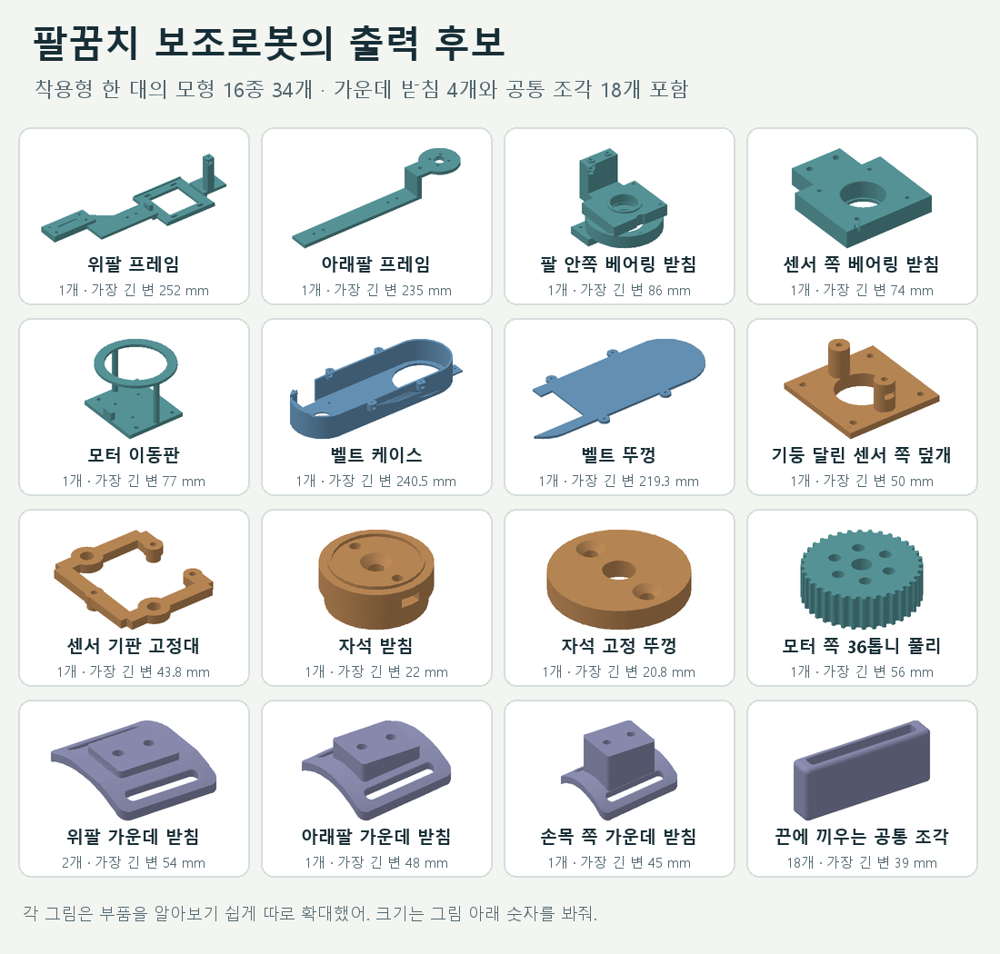

# 착용형 팔꿈치 보조로봇 3D 출력 검토

2026년 11월 25일 · 팔 한쪽 기준 · 도면 단위 mm

현재 기구를 전부 플라스틱으로 모형화하면 **16종 34개**다. 기존 통짜 팔 받침 네 개를 가운데 받침 네 개와 공통 조각 열여덟 개로 교체했다. 팔에 차고 모터를 켜는 시제품의 제작 수량은 프레임·관절 받침·팔 받침의 재료와 제작 방식을 정한 뒤 확정한다. 베어링 받침과 아래 케이스를 수정했다. [새 부품 4개와 조립 순서](bearing_seats/베어링_자리_조립.md)

## 한 대에 들어가는 기구

| 부품과 도면 | 수량 | 크기 또는 조립 기준 | 발주에 반영할 점 |
|---|---:|---|---|
| [위팔 프레임](guard_and_stops/UPPER_FRAME_REVIEW.step) | 1 | 82 × 252 × 58.5 | 케이스 고정 기둥이 붙은 버전. 모터·관절 하중을 받는다. |
| [아래팔 프레임](guard_and_stops/FOREARM_STOP_MOUNT_REVIEW.step) | 1 | 50 × 235 × 34 | 허브용 구멍 4개와 멈춤핀 자리가 있는 버전. |
| [멈춤홈이 있는 안쪽 베어링 받침](bearing_seats/FLOATING_BEARING_TOWER_REVIEW.step), [센서 쪽 베어링 받침](bearing_seats/LOCATING_BEARING_MOUNT_REVIEW.step) | 각 1 | 86 × 76 × 81.8 / 74 × 64 × 14 | 팔 쪽 구멍 Ø28.12, 센서 쪽 Ø28.05. 마감 치수와 두 받침의 축 정렬, 멈춤홈 강도는 실물로 확인한다. |
| [모터 이동판](guard_and_stops/MOTOR_CARRIER_WITH_COLLAR_REVIEW.step), [모터 앞 36톱니 풀리](../DM4340P_36T_FIT_ONLY.stl) | 각 1 | 77 × 77 × 53 / 약 Ø56 × 18.5 | 이동판은 원형 테두리 포함 버전. 풀리 파일은 무동력 맞춤용 형상이다. 실제 벨트 맞물림·볼트 체결·토크 전달 검토가 남았다. |
| [벨트 아래 케이스](bearing_seats/BELT_TRAY_OUTER_RING_STOP_REVIEW.step), [벨트 뚜껑](guard_and_stops/BELT_LID_REVIEW.step) | 각 1 | 97 × 240.5 × 35 / 97 × 219.3 × 2.5 | 아래 케이스의 턱과 팔꿈치 톱니바퀴 사이 공칭 간격은 1.40이다. 뚜껑은 길이에 비해 얇아 출력 후 평탄도와 나사 위치를 확인한다. |
| [기둥 달린 베어링 덮개](bearing_seats/LOCATING_SENSOR_COVER_REVIEW.step), [센서 기판 고정대](sensor_mount/GROVE_BOARD_BRIDGE_REVIEW.step) | 각 1 | 50 × 50 × 21.85 / 43.8 × 35.8 × 5.35 | 기둥이 달린 덮개가 이전 평평한 덮개를 대체한다. 기판 고정대를 좌우로 조절해 센서 중심을 맞춘다. |
| [자석 받침](sensor_mount/MAGNET_BASE_REVIEW.step), [자석 고정 뚜껑](sensor_mount/MAGNET_RETAINER_REVIEW.step) | 각 1 | Ø22 × 9.5 / Ø20.8 × 3.25 | 얇은 턱과 작은 너트 자리가 실제 출력에서 살아 있는지 확인한다. |
| 가운데 받침 [위팔 U31](segmented_cuffs/CENTER_U31.step) · [아래팔 F23](segmented_cuffs/CENTER_F23.step) · [손목 F16](segmented_cuffs/CENTER_F16.step) | 2 + 1 + 1 | 둘레 31 / 23 / 16 cm, 기존 M4 구멍 간격 14 mm | 위치에 맞는 가운데 받침을 프레임에 고정하고 양쪽에 끈을 단다. |
| [끈에 끼우는 공통 조각](segmented_cuffs/WEBBING_GUIDE.step) | 18 | 한 곳당 6 / 4 / 2개, 위팔 두 곳 | 같은 파일을 18개 출력한다. [STL 수량표와 조립 안내](segmented_cuffs/팔받침_조립.md) |

[팔 받침을 포함한 최신 전체 조립도](bearing_seats/ELBOW_BEARING_SEATS_ASSEMBLY_REVIEW.step)에는 기존 관절 조립의 88개 입체에 분할 받침 22개와 패드·끈의 대표 형상 8개를 더했다. 금속 축, 시판 허브, 팔꿈치 쪽 풀리·부시, 베어링 2개, 벨트, 멈춤핀, 나사류, 센서·자석, 패드·찍찍이는 출력 개수에서 제외했다. 배터리는 기존 허리·등 파우치 구상으로, ESP32 케이스와 배선 고정물은 이 관절 도면에 포함되지 않는다.

## 한 번에 주문하기 전 손볼 부분

1. **베어링과 아래 케이스.** 팔 쪽 바깥 링에는 양쪽으로 0.90씩, 센서 쪽 바깥 링에는 덮개까지 총 0.15의 여유를 뒀다. 케이스 턱의 안지름은 Ø25.50이다. 제작 후 구멍 크기와 턱의 실제 접촉 위치를 확인하고 모형 팔에서 손으로 축을 돌려 톱니바퀴가 케이스에 닿는지 살핀다. [수정 4종 조립과 실측 방법](bearing_seats/베어링_자리_조립.md)
2. **힘을 받는 프레임과 멈춤핀.** 아래팔 허브의 중심 홈과 나사 구멍 사이에 가장 얇게 남는 재료가 약 1.96이다. 팔이 회전 끝에 이르면 금속 멈춤핀이 출력 후보인 받침의 홈 끝을 누른다. 예를 들어 프로젝트의 잠정 토크 5~6 N·m가 반지름 29 mm 위치의 핀 하나에 정적으로 걸리면 접선 힘은 약 172~207 N이다. 실제 충격이나 파손 하중은 이 계산으로 구할 수 없다. 프레임·멈춤홈·모터판의 재료와 힘이 걸리는 방향을 정하고 모형 팔에서 하중·풀림·정지를 시험한 뒤 착용 시연을 판단한다. 종전의 PETG·채움 25%는 무동력 모형의 견적 조건이었다. [관절 설계 근거](팔꿈치_부품과_견적.md) · [멈춤핀 도면](guard_and_stops/덮개와_각도제한_조립.md)
3. **센서 자석 고정부.** 뚜껑에서 자석을 붙잡는 턱 두께는 축 방향 0.60이다. Ø12 축과 받침 구멍 Ø12.15 사이 여유는 한쪽 0.075다. 출력 오차에 따라 얇은 턱이 깨지거나 받침이 축에 끝까지 들어가지 않을 수 있다. 견적에는 실제 크기에서 얇은 턱과 너트 홈이 출력되는지, 끼움면의 마감과 치수 확인을 포함한다. 중심은 자석을 붙인 뒤 축을 손으로 돌리며 확인한다. [센서 조립 치수](sensor_mount/각도센서_조립.md) · [출력기 제조사의 얇은 벽·끼워맞춤 안내](https://help.prusa3d.com/article/modeling-with-3d-printing-in-mind_164135)
4. **모터와 동봉선.** DM4340P 참조 모델과 최신 착용형 조립도의 이동판·풀리에서 뒷면 4곳(맞은편 중심 사이 38), 앞쪽 회전면 6곳(27)의 위치가 일치했다. 이동판 체결부는 두께 4, 통과 구멍 Ø3.4다. 뒷면 나사는 V1.0 설명서에 M2.5, 별도 설치도에 M3로 표시되어 수령품 규격으로 선택한다. 이전의 몸체 간섭 검사에서도 이동판·모터 풀리와 겹침이 없었고, 케이스·뚜껑·위팔 프레임은 이동판 위치 −3, 0, +3에서 몸체와 겹치지 않았다. [제조사 설명서 4쪽](https://doc.switch-science.com/media/files/5e033168-99f1-4d2d-b758-e03192a1f071.pdf#page=4) · [제조사 카탈로그의 설치도 12쪽](https://www.worldrobotconference.com/profile/robot/download/2025/06/30/%E8%BE%BE%E5%A6%99%E7%A7%91%E6%8A%80DAMIAO%20-%202025%E5%B9%B4%E4%BA%A7%E5%93%81%E9%80%89%E5%9E%8B%E6%89%8B%E5%86%8C_20250630192546A441.pdf#page=12)

   케이블은 어깨 방향 소켓으로 빼는 배치를 검토했다. 몸통 가장자리에서 어깨 방향으로 기둥이 시작되는 위치까지는 모터판을 팔꿈치 쪽 끝 / 가운데 / 어깨 쪽 끝에 놓으면 각각 **17 / 14 / 11 mm**다. 소켓 높이에서 폭 16 × 높이 7의 가상 공간으로 확인했다. 기둥이 중심선에서 오른쪽으로 6 mm 비켜 있어, 실제로 닿는지는 꽂은 플러그의 폭과 선이 나오는 방향에 따라 달라진다. 전원을 분리하고 아래 1:1 종이 도면과 대조한다. 겹치면 옆에서도 높이를 확인하고, 접촉하면 발주 전 케이블 경로나 기둥을 재검토한다. 출력 후에는 양 끝 위치에서 플러그 탈착, 선의 눌림과 벨트 접촉 여부를 확인한다. [모터와 케이블 실물 대조용 A4](DM4340P_실물대조_A4.pdf)

## 분할하지 않고 들어가는 크기

가장 긴 부품은 위팔 프레임(252)이다. 최신 형상을 현재 높이 방향 그대로 두고 평면에서 돌려, 부품 하나가 차지하는 정사각형 크기를 계산했다. 위팔 프레임은 약 **201 × 201**, 아래팔 프레임은 **183 × 183**, 벨트 아래 케이스는 **190 × 190** 안에 들어간다. 위팔 부품에 사방 5씩 바닥 부착 여유를 잡으면 약 211 × 211 이상이 필요하다. 이는 부품 자체의 투영 크기 기준으로, 실제 사용 가능한 출력판, 서포트, 가장자리 여유와 출력 방향은 업체 설정에 맞춰야 한다. 치수 배율은 100%로 유지한다.

## 검토 범위와 견적

기존 기구 12종에 이어 분할 받침 4종의 단일 입체와 닫힌 출력 메시를 확인했다. 가운데 받침 네 자리는 현재 프레임의 체결면에 닿았고, 모형의 팔꿈치 각도 15~90°를 1°씩 바꿨을 때 검사한 고정 부품과 분할 받침이 겹치지 않았다. 실제 팔의 눌림이나 찍찍이·케이블 움직임, 출력물 강도는 실측 전이다.

기존 **37,006원은 손조립 모형 9종 10개**에 대한 견적이다. 탁상형 ZIP의 2개 역시 다른 구성이다. 이번 16종 34개의 출력 가격은 미확정이다. 견적을 합칠 때는 기둥 달린 덮개와 최신 프레임을 각 1개씩 사용하고, 옛 시험축·시험축 받침·이전 모터 이동판과 통짜 팔 받침은 제외한다.
