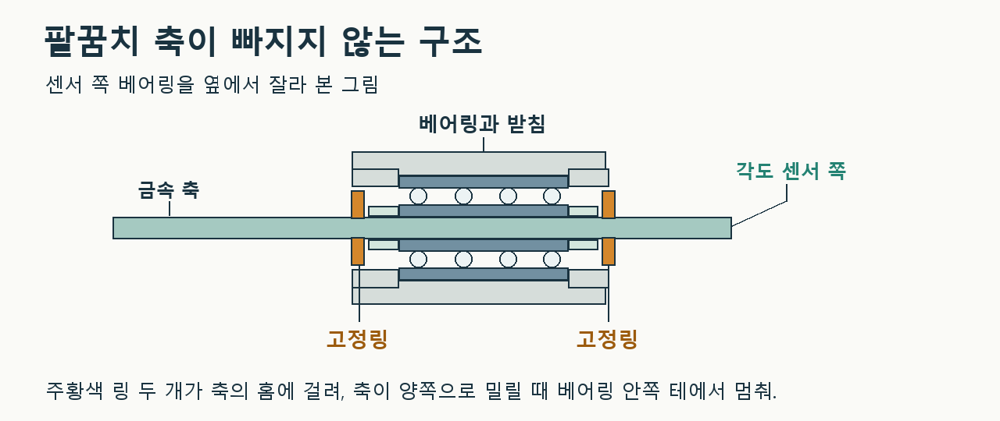

# 팔꿈치 축 빠짐 방지

센서에 가까운 베어링 한 곳에서 축의 좌우 위치를 잡는다. 금속 축의 홈에 고정링을 하나씩 끼우고, 링과 베어링 사이에 얇은 금속 간격링을 넣는다. 축이 밀리면 한쪽 고정링이 베어링 안쪽 테에 힘을 전한다. 베어링 바깥 테는 받침의 턱과 나사로 고정한 덮개 사이에 머문다. 센서 쪽 축 끝에는 자석을 놓을 자리를 남긴다.

## 이번 설계에서 바뀐 부품

| 부품 | 한 세트 기준 | 설계 치수와 역할 |
|---|---:|---|
| 금속 축 | 1개 | 지름 12 mm, 길이 80 mm. 기존 톱니바퀴 쪽 키홈 위치를 유지하고 센서 쪽으로 축을 1 mm 옮겼다. 현재 검토안은 양끝 암나사 대신 고정링 홈 두 곳을 사용한다. |
| 축용 고정링 | 2개 | Rotor Clip DSH-12 또는 동일한 홈 치수를 요구하는 DIN 471 제품. 제조사 제시 홈 지름 11.390–11.500 mm, 홈 폭 1.100 mm, 링 두께 0.940–1.000 mm. [Rotor Clip 규격](https://www.rotorclip.com/product/dsh-12/) |
| 베어링 안쪽 테용 금속 간격링 | 2개 | 내경 12.1 × 외경 15 × 두께 1 mm 제안. NSK 6001의 축 받침 허용 지름 14–15.5 mm에 맞췄다. [NSK 6001 받침 치수](https://www.nsk.com/engineering/products/bearings/ball-bearings/deep-groove-ball-bearings/single-row-deep-groove-ball-bearings/6001-apn.html) |
| 센서 쪽 베어링 받침 및 덮개 | 각 1개 | 베어링 바깥 테를 받는 턱과 덮개의 안지름은 11월 25일 수정 도면에서 25.50 mm. [최신 받침·덮개](../bearing_seats/베어링_자리_조립.md) 나사 4개 중심은 38 × 38 mm 정사각형에 있다. |
| 덮개 체결용 볼트·너트 | 각 4개 | M3 × 20 육각머리 볼트와 풀림 방지 너트 후보. 받침 뒷면 육각 홈이 볼트 머리를 잡고 센서 쪽에서 너트를 조이는 배치다. [볼트 규격 예](https://eshop.wuerth.de/Hexagon-bolt-with-thread-up-to-head-ISO-4017-steel-88-plain-SCR-HEX-ISO4017-88-WS55-M3X20/00553%20%2020.sku/en/) |

## 축 도면을 보는 기준

팔에 가까운 축 끝을 0 mm로 잡는다. 첫 번째 고정링 홈은 62.8–63.9 mm, 두 번째 홈은 74.1–75.2 mm 구간이다. 두 번째 홈 바깥에 4.8 mm가 남는다. 톱니바퀴용 키홈은 이전 배치대로 39–59 mm 구간의 폭 4 mm를 사용했다. 키의 실제 높이와 부시 홈, 축의 베어링 끼워맞춤 및 홈 모서리 공차는 가공 도면 확정 때 대조한다. 미스미는 키홈 축에 고정링 홈을 두 곳 지정하는 가공 옵션을 제공한다. 공급사 홈 폭과 DSH-12의 일치 여부, 해당 조합의 주문번호·금액·납기는 미확정이다. [미스미 키홈 축 카탈로그](https://kr.misumi-ec.com/pdf/fa/2018/P1_853_002_202106.pdf)

## 3D 도면에서 확인한 값

| 확인 항목 | 결과 |
|---|---|
| 축이 밀릴 때 | 좌우 각각 고정링 → 간격링 → 베어링 안쪽 테로 전달되는 접촉과, 바깥 테가 턱·덮개에 걸리는 위치를 확인했다. |
| 덮개와 베어링 바깥 테 | 기본 위치에서 축 방향 여유 0.15 mm. 덮개를 조일 때 바깥 테를 강제로 압축하지 않도록 잡은 설계값이다. |
| 고정링과 주변 부품 | 지름 20 mm 회전 공간을 가정했을 때 받침 턱·덮개 안쪽까지 반지름 방향 2.75 mm(안지름 25.50 기준). 안쪽 고정링과 톱니바퀴의 단순 외형 사이에는 축 방향 2.8 mm. |
| 센서 자리 | 축 끝에서 기존 센서 예약 공간까지 축 방향 1.0 mm. 체결물과 예약 공간의 최단거리는 2.26 mm. 이 수치는 자석과 센서 칩 사이의 감지 거리가 아니다. 실제 센서판·자석 홀더 형상과 자기장 측정은 다음 검토 대상이다. |
| 조립 접근 | 풀리 쪽에서 볼트를 받침에 먼저 넣고, 센서 쪽에서 덮개를 끼우는 경로상의 중간 위치를 검사했다. 링 전용 플라이어와 너트 공구가 들어갈 자리는 주변 프레임까지 조립할 때 실물로 확인한다. |

간격링 두 개와 베어링 폭을 합한 기준 길이는 10 mm다. 홈 치수 및 링 두께만 고려하면 조립 후 축과 베어링 안쪽 테 사이에 생길 수 있는 좌우 총 이동량은 약 0.20–0.52 mm다. 받침과 덮개의 여유 0.15 mm, 베어링 내부 유격, 가공 및 출력 오차가 더해지므로 실제 흔들림은 측정해야 한다. 허브 쪽 베어링은 축 방향으로 움직일 여유가 있는 구조로 맞춘다. 이전 안에서 센서 쪽 베어링과 풀리 사이에 제안했던 5 mm 통간격링은 이 조립에서 제외한다.

## 모형 팔 조립 때 확인할 순서

1. 받침 뒤쪽의 육각 홈 4개에 볼트 머리를 먼저 넣는다. 축에 풀리 쪽 고정링과 첫 간격링을 끼운다.
2. 센서 쪽 받침과 베어링을 배치한다. 바깥쪽 간격링과 두 번째 고정링을 끼우고 두 링이 홈에 완전히 들어갔는지 확인한다.
3. 덮개를 끼우고 너트를 고정한다. 전원을 끈 채 축을 손으로 돌리고 밀고 당겨, 걸림과 좌우 이동량을 확인한다.

[조립 검토 STEP](ELBOW_SHAFT_AXIAL_REVIEW.step) · [축 단품 STEP](ELBOW_SHAFT_GROOVES_REVIEW.step)

조립 STEP의 16개 솔리드는 표준 베어링과 고정링의 공간을 단순화한 형상을 포함한다. 열림·유효성·본체 수·체적을 다시 확인했다. 위팔에 장착할 때는 뒤쪽 체결부가 추가된 [두 받침과 위팔 프레임의 통합 조립도](../upper_bearing_mount/위팔_받침_조립.md)를 함께 본다. 홈이 있는 축의 반복 강도, 받침 재질과 나사 체결 강도, 허브 미끄러짐 및 부하를 건 정지는 실물 검증 전이다. 현재 도면은 조립 검토용이다.
