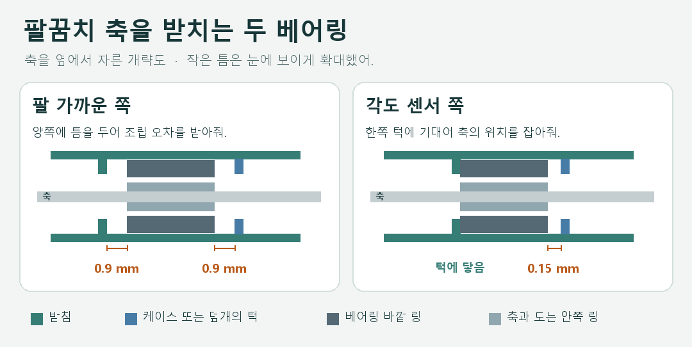

# 팔꿈치 베어링 두 곳 조립하기

2026년 11월 25일 · 모형 팔 한쪽 기준 · 치수 단위 mm

베어링은 금속 축이 부드럽게 돌아가게 받쳐 주는 부품이다. **팔 가까운 쪽**은 베어링이 축을 따라 앞뒤로 조금 움직일 자리를 뒀다. **각도 센서 쪽**은 베어링을 받침과 덮개 사이에 놓아 축의 위치를 잡는다. 두 곳 모두 턱이 베어링의 바깥 링 가장자리를 받는 구조다.

## 교체할 도면

| 한 대에 각 1개 | 조립할 때 알아볼 곳 |
|---|---|
| [팔 쪽 베어링 받침](FLOATING_BEARING_TOWER_REVIEW.step) | 멈춤핀이 움직이는 곡선 홈을 유지했다. 베어링을 벨트 쪽에서 넣는다. |
| [벨트 아래 케이스](BELT_TRAY_OUTER_RING_STOP_REVIEW.step) | 원형 홈이 받침 끝의 둥근 돌기를 덮는다. 홈 안쪽에 베어링 바깥 링이 닿을 턱이 있다. |
| [센서 쪽 베어링 받침](LOCATING_BEARING_MOUNT_REVIEW.step) | 센서 쪽에서 베어링을 넣어 안쪽 턱에 댄다. |
| [센서 쪽 덮개](LOCATING_SENSOR_COVER_REVIEW.step) | 기판용 기둥이 달린 덮개다. 베어링이 바깥쪽으로 빠지는 것을 막는다. |

네 부품은 기존 목록에 한 개씩 이미 들어 있다. 출력 모형 전체는 **16종 34개**다. 이 변경에 추가 베어링·나사·간격링은 필요하지 않다. [수정 4종 STL과 수량표](베어링자리_수정4종_STL.zip) · [전체 조립 STEP](ELBOW_BEARING_SEATS_ASSEMBLY_REVIEW.step) · [전체 출력 목록](../3D출력_검토.md)

## 모형 팔에서 조립하는 순서

1. **팔 쪽부터 끼운다.** 배터리를 분리하고 벨트 아래 케이스를 열어 둔다. 베어링(6001)을 벨트 쪽 입구에서 손으로 곧게 넣는다. 케이스를 조이는 힘으로 베어링을 밀어 넣으면 걸림을 알아차리기 어렵다.
2. **팔 쪽 위치를 잡고 케이스를 얹는다.** 도면의 가운데 위치에서는 베어링 끝면이 받침의 평평한 케이스 장착면보다 **1.5 mm** 튀어나온다. 깊이자로 확인한 뒤 케이스 원형 홈을 받침 돌기에 맞춘다. 이 위치에서 베어링 바깥 링과 양쪽 턱 사이에는 각각 **0.9 mm**가 남는다.
3. **센서 쪽을 닫는다.** 축에 풀리 쪽 고정링과 첫 간격링을 먼저 끼운다. 센서 쪽 받침과 베어링을 배치하고 베어링 바깥 링을 받침 턱에 댄다. 바깥쪽 간격링과 두 번째 고정링을 끼우고 덮개를 고정한다. 바깥 링과 덮개 사이에 **총 0.15 mm**가 남도록 설계했다. [고정링 조립 순서](../axial_retention/축_고정_설계.md)
4. **축을 손으로 돌려 본다.** 모형 팔을 지지하고 축을 양쪽으로 가볍게 밀어 가며 돌린다. 뚜껑을 닫기 전 톱니바퀴와 케이스 사이 최소 틈을 확인한다. 덮개를 조인 뒤 뻑뻑해지거나, 긁히는 소리·접촉 자국이 생기면 전원을 분리한 채 베어링 자리, 턱, 케이스 휨을 확인한다. 팔 쪽의 0.9 mm는 **베어링 바깥 링이 움직일 자리**다. 완성한 축 전체의 좌우 흔들림은 따로 측정한다.

## 제작 치수와 실측 항목

| 항목 | 도면과 제작 기준 |
|---|---|
| 베어링 | NSK 6001, 안지름 12 · 바깥지름 28 · 폭 8. 제조사가 제시하는 하우징 턱의 안지름 상한은 26이다. 여기서 턱의 안지름은 25.50으로 설계했다. [NSK 6001 치수표](https://www.nsk.com/engineering/products/bearings/ball-bearings/deep-groove-ball-bearings/single-row-deep-groove-ball-bearings/6001-apn.html) |
| 베어링이 들어갈 구멍 | 팔 쪽 도면 Ø28.12, 센서 쪽 Ø28.05. **무동력 손조립**용 마감 목표는 각각 Ø28.08~28.16, Ø28.02~28.08이다. 내경 측정기로 입구와 안쪽을 직각 두 방향에서 재고 실제 베어링 외경과 비교한다. 작거나 타원형이면 축 중심을 유지하며 마감하고, 너무 크면 해당 받침을 다시 제작한다. 최종 구동용 끼워맞춤은 받침 재료와 하중에 맞춰 별도로 정해야 한다. [NSK 끼워맞춤 안내](https://www.nsk.com/tools-resources/abc-bearings/fits-and-internal-clearance/) |
| 팔 쪽 이동 | 양쪽 턱 사이 9.80, 베어링 폭 8.00. 가운데에서 양쪽으로 0.90씩 이동한다. 한쪽 끝으로 갔을 때에도 원통 자리가 바깥 링을 길이 7.35 이상 받친다. 덮기 전 양쪽 턱의 거리와 베어링 폭을 깊이자로 대조한다. |
| 케이스와 톱니바퀴 | 케이스의 턱 두께 1.20. 턱을 높인 만큼 톱니바퀴 쪽 공간이 줄었다. 공칭 위치에서 간격은 1.40이며, 톱니바퀴가 케이스 쪽으로 0.70 밀린다고 가정하면 0.70이 남는다. 출력물 휨과 톱니바퀴 흔들림은 실물에서 잰다. |
| 아래팔 허브와 팔 쪽 받침 | 제조사 허브 도면을 0°, 34°, 90°에 놓고, 각 자세에서 허브를 받침 쪽으로 0.70 이동한 경우도 검사했다. 검사한 위치에서의 최소 간격은 0.80이다. |
| 턱의 접촉 위치 | 바깥 링의 가장자리만 받도록 설계했다. Ø24.8의 중심 공간과 중심 편차 0.20을 가정해 도면에서 간섭을 확인했다. 실제 6001의 볼·유지기 등 내부 부품 외형은 단순화했다. 실제 베어링을 대고 안쪽 링을 돌려 턱이 회전부에 닿는지 확인한다. |

도면 검사는 조립 위치와 틈에 관한 것이다. 턱이 실제로 버티는 하중, 출력물의 변형, 움직이는 축과 베어링 안쪽 링 사이의 끼워맞춤은 실물에서 확인해야 한다. 착용 동력 시연 전에는 모형 팔에서 하중과 정지 동작을 확인하는 단계가 남아 있다. [도면 검사값](checks.json)
