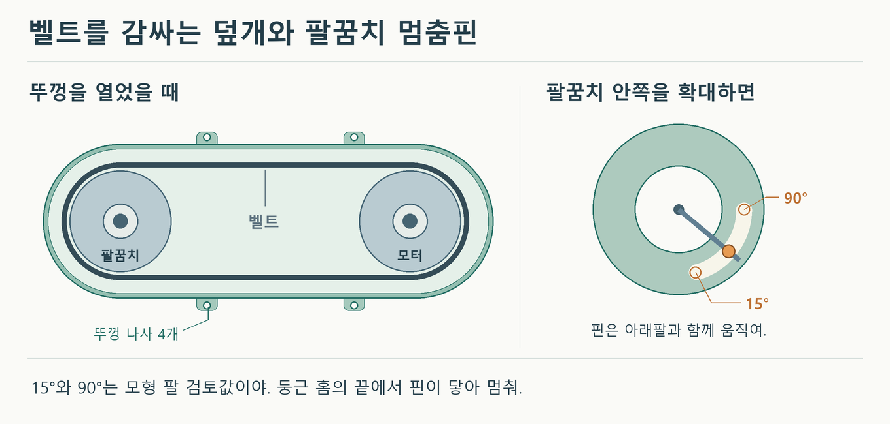

# 벨트 보호덮개와 팔꿈치 멈춤핀

2026년 11월 24일 · 모형 팔 한 세트의 조립 검토

덮개는 위팔에 고정되어 모터 쪽 톱니바퀴, 팔꿈치 쪽 톱니바퀴와 그 사이의 벨트를 감싼다. 아래팔 프레임에 고정한 금속 핀은 팔꿈치 받침의 둥근 홈을 따라 움직인다. 핀이 홈 끝에 닿으면 아래팔 프레임의 회전을 기계적으로 막도록 설계했다. 두 장치는 따로 고정된다.

## 추가하거나 바꾼 것

| 구분 | 한 세트에 쓰는 부품 |
|---|---|
| 새 덮개 2개 | 아래 케이스 1개와 분리형 뚜껑 1개. 케이스는 팔꿈치 쪽 2곳과 모터 너머 위팔 프레임 1곳에 지지된다. |
| 기존 도면 대체 4개 | 위팔 프레임에 케이스 지지 기둥, 팔꿈치 안쪽 베어링 받침에 멈춤홈, 아래팔 프레임에 핀 체결 자리, 모터 이동판에 벨트 입구를 가리는 원형 테두리를 각각 추가했다. 이전 버전과 중복 주문하지 않도록 최종 목록에는 최신 버전을 넣는다. |
| 덮개 체결물 | M3 × 12 육각구멍 원통머리 볼트 7개, M3 풀림 방지 너트 7개. 뚜껑에 4세트, 아래 케이스에 3세트를 쓴다. 앞서 산정한 베어링 받침·덮개용 M3 × 20 및 M4 볼트는 별개다. |
| 금속 멈춤핀 | ISO 7379 어깨볼트 1개. 매끈한 부분 지름 6 × 길이 12 mm, 나사 M5 × 길이 9.5 mm, 머리 지름 10 × 높이 4.5 mm 기준이다. M5 평와셔 1개(외경 10 × 두께 1 mm), 높이 4 mm M5 육각너트 1개를 더한다. 동일 M5여도 너트 높이가 달라지면 축방향 여유가 달라진다. 금속 나사부 풀림 방지제는 보유분과 재질 적합성을 확인한다. [Ganter 어깨볼트 도면](https://live-katalog.ganternorm.com/pdf/ganter/EN/7379.pdf) · [M5 너트 규격 예](https://eshop.wuerth.de/Hexagon-nut-DIN-934-steel-I6I-I8I-plain-NUT-HEX-DIN934-I6I-WS8-M5/03105.sku/en/US/EUR/) · [금속 나사용 풀림 방지제 예](https://next.henkel-adhesives.com/us/en/products/industrial-adhesives/central-pdp.html/loctite-243/BP000000316211.html) |

## 처음 조립할 때

1. 배터리를 분리하고 모형 팔을 지지한다. 센서 쪽 베어링 받침과 아래 케이스를 열어 둔다. 아래팔 프레임을 도면 기준 90°에 놓으면, 팔꿈치 안쪽 받침의 공구 홈과 멈춤핀 자리가 나란해진다.
2. 어깨볼트를 열린 바깥쪽에서 고정된 원호 홈과 아래팔 프레임으로 넣는다. 아래팔 프레임 안쪽에 와셔와 너트를 설치한다. 매끈한 몸통이 홈 속에서 움직이고, 볼트의 어깨가 아래팔 프레임에 닿는지 확인한다. 전원이 분리된 상태에서 손으로 홈의 양 끝을 확인한다.
3. 모터를 이동판의 테두리 안으로 넣고 고정한다. 팔 쪽 베어링을 열린 벨트 쪽에서 먼저 넣고, 아래 케이스의 M3 너트와 볼트 3세트를 설치한 뒤 벨트·톱니바퀴를 배치한다. 각도 센서 쪽 베어링 받침, 베어링, 축 고정링과 덮개를 [축 조립 순서](../axial_retention/축_고정_설계.md)에 맞춰 조립한다. 실제 모터 커넥터 위치, 선이 빠져나가는 방향, 렌치 접근과 냉각 여유는 모터 실물로 대조한다.
4. 벨트가 한쪽으로 쏠리거나 닿지 않는지 손으로 돌려 확인한 뒤, 바깥 뚜껑의 M3 볼트 4개를 조인다. 움직이는 원형 테두리가 모터 이동판을 따라가며 케이스 아랫면의 긴 구멍을 겹쳐 가린다.

**점검과 교체.** 벨트를 눈으로 살필 때는 배터리를 분리하고 바깥 나사 4개를 풀어 뚜껑을 들어 올린다. 벨트를 완전히 바꿀 때는 모터 이동판에서 장력을 풀고 센서 쪽 받침과 축 고정 부품을 분리해 팔꿈치 쪽 톱니바퀴로 접근한다. 필요하면 풀리와 벨트를 함께 들어낸다. 실물 부시의 풀림 나사 위치와 공구가 들어갈 공간은 별도 확인 항목이다.

## 도면에서 확인한 범위

| 검사 | 결과 |
|---|---|
| 벨트 간격 | 모터 위치를 가운데와 앞뒤 3 mm에 놓고 검사했다. 새 덮개·해당 체결물까지 벨트 외형은 최소 **4.17 mm**, 11월 24일 케이스에서 팔꿈치 톱니바퀴 외형은 **2.47 mm**, 모터 톱니바퀴 외형은 **3.98 mm** 떨어졌다. 기존 베어링 받침과 벨트 사이의 **3.85 mm**도 고려했다. 11월 25일 수정한 케이스의 턱과 팔꿈치 톱니바퀴 사이는 공칭 **1.40 mm**, 축이 케이스 쪽으로 0.70 mm 이동한다고 가정하면 **0.70 mm**다. [변경값과 조립](../bearing_seats/베어링_자리_조립.md) |
| 모터 쪽 하부 | 원형 테두리와 케이스 사이 축 방향 여유는 **1.5 mm**, 장력 조절 끝 위치에서 긴 구멍을 가리는 최소 겹침은 **2.5 mm**다. 실물의 틈새 접근성, 옷감·전선 유입 및 커넥터 간섭은 미검증이다. |
| 정비 | 베어링 받침이 제자리에 있을 때 뚜껑이 바깥으로 55 mm 이동하는 전체 공간을 확인했다. 센서판은 기존 예약 공간을 사용했다. 받침·고정링을 분리한 상태에서 느슨한 쪽 배치의 벨트 외형과 팔꿈치 풀리 외형을 꺼낼 공간도 검사했다. |
| 각도 제한 | 도면상 팔이 펴진 방향을 0°로 놓았다. 모형 팔의 공칭 멈춤 위치는 **15°와 90°**다. 핀과 홈의 치수 여유를 반영해 홈 끝 위치를 잡았다. 15.25°와 89.75°에서는 떨어져 있고, 15°와 90°에서는 접촉하며, 14.5°와 90.5°로 더 돌리면 형상이 겹친다. 15–90° 사이를 1°씩 움직이며 아래팔·체결물과 새 고정부 사이에 의도치 않은 겹침이 없는지 검사했다. |

이 각도는 모형 팔에 선택한 임시 설계값이다. 실제 끝 각도는 출력 오차와 핀 치수, 축 유격 및 탄성 변형으로 달라진다. 금속 핀이 있어도 힘을 받는 곳에는 출력한 홈 끝과 아래팔 프레임이 포함된다. 반복 충격과 파손 강도는 실물 검증 전이다. 정상 구동은 핀이 닿기 전에 제어기로 멈추도록 설정하며, 사람 착용 전에는 모형 팔에서 하중·독립 정지·정렬을 검증하고 착용자에게 맞는 범위를 담당자와 검토한다.

## 덮개와 멈춤핀 도면

센서판, 자석 및 고정대를 추가한 단계에서는 센서 플러그를 뽑고 벨트 뚜껑을 55 mm 들어 올리는 경로까지 확인했다. [센서 포함 전체 조립도](../sensor_mount/ELBOW_SENSOR_ASSEMBLY_REVIEW.step) · [센서 설치 방법](../sensor_mount/각도센서_조립.md)

[45° 조립 검토 STEP](GUARD_STOP_ASSEMBLY_REVIEW.step)에는 두 톱니바퀴와 벨트·모터·허브의 배치 참고 형상이 들어 있다. 케이블, 센서판, 출력 변형 및 벨트의 실제 이 맞물림은 단순화했다. 이 파일은 부품 배치를 검토하는 용도다.

- [아래 케이스](../bearing_seats/BELT_TRAY_OUTER_RING_STOP_REVIEW.step) · [바깥 뚜껑](BELT_LID_REVIEW.step)
- [위팔 프레임](UPPER_FRAME_REVIEW.step) · [멈춤홈이 있는 안쪽 베어링 받침](../bearing_seats/FLOATING_BEARING_TOWER_REVIEW.step)
- [핀을 고정하는 아래팔 프레임](FOREARM_STOP_MOUNT_REVIEW.step) · [하부 테두리가 있는 모터 이동판](MOTOR_CARRIER_WITH_COLLAR_REVIEW.step)

최종 출력 발주 전에는 DM4340P의 실제 고정 구멍·커넥터·동봉선과 모터판을 대조한다. 아래 케이스는 길이 약 240.5 mm여서 배율 100%를 유지할 수 있는 출력 방향과 장비, 출력비도 최종 견적에 반영한다.
