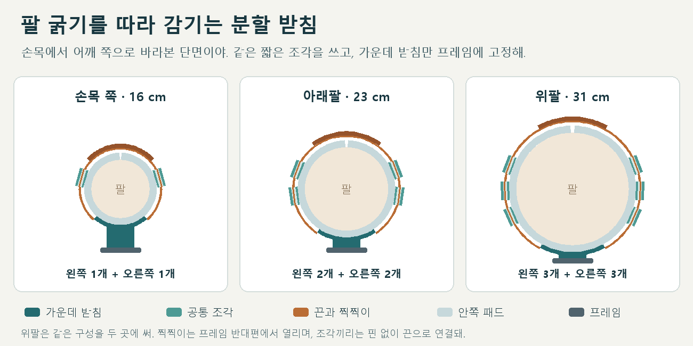

# 끈으로 감는 분할 팔 받침

2026년 11월 25일 · 팔 한쪽 · 모형 맞춤용 설계

가운데 받침이 나사 두 개로 프레임을 잡는다. 양쪽 끈에는 동일한 짧은 조각을 꿴다. 끈이 조각 사이에서 휘면서 팔 둘레를 따라간다. 프레임 반대편에는 딱딱한 부품을 두지 않아, 양쪽 끈 끝을 겹쳐 찍찍이를 여닫을 수 있다.

| 위치 | 가운데 받침 | 끈에 끼울 조각 | 끈 한쪽의 초벌 길이 |
|---|---|---|---|
| 손목 쪽 16 cm | [F16](CENTER_F16.step) 1개 | 왼쪽 1 + 오른쪽 1 | 약 175 mm, 2가닥 |
| 아래팔 팔꿈치 쪽 23 cm | [F23](CENTER_F23.step) 1개 | 왼쪽 2 + 오른쪽 2 | 약 205 mm, 2가닥 |
| 위팔 31 cm, 두 곳 | [U31](CENTER_U31.step) 각 1개 | 한 곳당 왼쪽 3 + 오른쪽 3 | 약 245 mm, 4가닥 |

**출력물은 4종 22개**다. 가운데 받침 4개와 [같은 끈 조각](WEBBING_GUIDE.step) 18개다. 예전 통짜 받침 4개를 이 구성으로 바꾼다. 전체 로봇의 출력 후보는 16종 34개다. [팔 받침 전용 STL과 수량표](팔받침_맞춤용_STL.zip) · [로봇 전체 출력 검토](../3D출력_검토.md)

## 어떻게 조립할까

1. **가운데 받침부터 고정한다.** U31은 위팔 두 곳, F23은 팔꿈치 가까운 아래팔, F16은 손목 쪽이다. 아래팔 받침은 넓어지는 쪽이 팔꿈치를 향한다. 평평한 면을 프레임에 대고 기존 Ø4.5 mm 구멍 두 개(중심 간격 14 mm)에 맞춘다. 각도 센서나 모터선을 끈 사이에 넣지 않는다.
2. **양쪽에 끈을 한 가닥씩 단다.** 폭 30 mm의 늘어남이 적은 끈을 가운데 받침의 양 끝 구멍에 각각 통과시킨다. 각 끝은 바깥쪽으로 돌려 같은 끈에 겹쳐 꿰맨다. 출발점으로 한쪽당 접힘·봉제 여유 45 mm를 잡았고, 두 겹인 구간은 첫 조각보다 가운데 쪽에 둔다. 실제 끈·봉제 여유를 확인한 뒤 재단한다.
3. **짧은 조각을 꿴다.** 둥근 모서리가 있는 조각을 각 끈의 자유단에서 표의 수만큼 넣는다. 공통 조각은 16 × 39 × 7.2 mm, 안쪽 통로는 33 × 3.6 mm다. 모형 팔에 감아 자리를 표시한 뒤 조각 양옆에 낮은 천 멈춤 고리를 봉제해 조각이 한쪽으로 몰리지 않게 한다. 고리는 통로 입구를 통과하지 않는 크기로 맞추고 접힌 끈이나 찍찍이가 조각 속으로 들어가지 않게 한다.
4. **피부 쪽을 패드로 덮고 닫는다.** 각 위치에 폭 50 mm, 두께 약 6 mm의 부드러운 패드를 한 줄로 두른다. 처음 검토한 폭 55 mm에서는 팔꿈치를 90° 굽힐 때 아래팔 쪽과 위팔 쪽이 한 곳에서 닿아 폭을 줄였다. 조각 사이, 나사 머리와 끈 아래까지 덮고, 패드 양끝은 부드럽게 만나게 한다. 양쪽 끈 자유단에 봉제형 찍찍이를 서로 마주 보게 달고 반대편에서 겹친다. 겹침 60 mm는 공간 검토에 쓴 초안이다. 실제 붙잡는 힘과 한 손으로 풀리는지는 실물에서 확인한다.

## 무엇을 맞춰 봤나

- 원형 단면과 아래팔의 완만한 굵기 변화를 반영했다. 피부 쪽을 6 mm 패드로 감싸고 그 바깥에서 폭 30 mm 끈이 짧은 조각의 통로를 지난다. 끈 한 겹 1.4 mm, 접어 꿰매는 구간 2.8 mm, 찍찍이 겹침부 총 4.8 mm를 가정했다. 실제 보유한 끈의 폭·두께와 봉제선 두께를 재야 한다.
- 손목·아래팔·위팔 각 위치에서 감은 상태의 딱딱한 부품끼리 가장 가까운 간격은 각각 **25.1 / 6.0 / 6.7 mm**였다. 조각 사이로 끈이 지나가고, 뒤쪽에는 각각 약 75 / 95 / 128 mm의 부드러운 구간이 남는다. 실제 팔의 눌림이나 허용 둘레 범위를 측정한 값은 아니다.
- 기존 두 프레임의 체결면과 구멍을 대조했다. 안쪽 머리 Ø8 × 높이 2 mm 이하의 M4 나사를 기준으로 파낸 자리를 만들었다. 나사 길이는 세 받침의 높이가 달라 실물 받침·프레임·와셔·너트를 합친 두께로 고른다. 위팔 받침은 모터판 아래에서 걸리던 끝부분을 다듬어 두 개를 공용으로 쓸 수 있게 했다.
- 최신 조립도에 받침·조각·패드와 끈의 대표 형상을 넣고, 모형 팔의 15~90° 구간을 1° 간격으로 검사했다. 검사한 자세에서 새 받침이 프레임이나 반대쪽 받침과 겹치지 않았다. 끈을 구멍에 돌려 꿰매는 실제 접힘, 천 멈춤 고리, 패드 압축과 인체 형상은 상세 모델에서 생략했다. [팔 받침 검토 당시 45° 조립도](ELBOW_WITH_SEGMENTED_CUFFS_REVIEW.step) · [손목 받침 확대 STEP](WRIST_CUFF_REVIEW.step) · [치수 검사 결과](checks.json)
- 네 종류의 STL을 다시 열어 실제 크기, 닫힌 표면, CAD 체적과의 일치를 확인했다. 출력 후 끈 구멍과 조각 입구의 거친 면을 매끄럽게 하고 끈을 여러 번 왕복시켜 걸림·쓸림을 살핀다.

먼저 16·23·31 cm 모형에 감고 프레임과 모형에 기준선을 하나씩 표시한다. 모터 전원을 분리한 채 프레임을 손으로 비틀고 굽혔다 펼 때 두 선이 어긋나는지, 조각이 몰리거나 찍찍이가 벗겨지는지 확인한다. 분할 받침의 모터 하중 전달과 착용 중 압박은 검증 전이다. 최신 전체 조립도에는 베어링 받침과 벨트 케이스의 변경도 반영했다. [수정 도면과 조립 안내](../bearing_seats/베어링_자리_조립.md)
