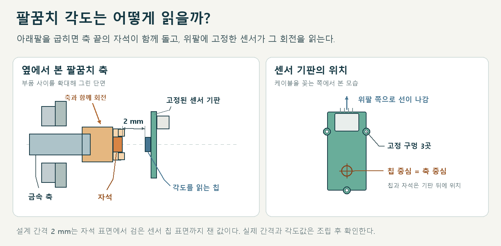

# 팔꿈치 각도 센서와 자석 조립

2026년 11월 24일 · 모형 팔 조립 검토용 · 길이 단위 mm

자석은 아래팔과 함께 도는 금속 축 끝에 붙고, 센서는 위팔에 고정된다. 자석의 방향이 바뀌면 센서가 팔꿈치가 얼마나 굽혀졌는지 읽는다. 센서 선은 위팔 쪽으로 뺀다.

## 무엇을 준비할까

| 구분 | 1대에 들어가는 부품 | 비고 |
|---|---|---|
| 센서와 자석 | Seeed Grove AS5600 101020692 1개, Radial Magnets 9042 1개 | 기존 선택품. 자석은 지름 6 × 두께 2.5, 지름 방향 자화 제품이다. [기판 도면](https://wiki.seeedstudio.com/Grove-12-bit-Magnetic-Rotary-Position-Sensor-AS5600/) · [자석 사양](https://radialmagnet.com/our-magnets/n35-nicuni-d6mmax2-5mm/) |
| 출력 형상 | 기둥을 더한 [베어링 덮개](../bearing_seats/LOCATING_SENSOR_COVER_REVIEW.step) 1개, [기판 고정대](GROVE_BOARD_BRIDGE_REVIEW.step) 1개, [자석 받침](MAGNET_BASE_REVIEW.step) 1개, [자석 고정 뚜껑](MAGNET_RETAINER_REVIEW.step) 1개 | 기존 센서 쪽 덮개 1개를 교체하고 새 형상 3개를 추가한다. 얇은 자석 고정 턱과 나사 자리의 실제 출력 품질은 미확인이다. |
| 금속 축 | [센서 쪽 끝에 M3 나사 구멍을 추가한 축](SENSOR_END_SHAFT_REVIEW.step) 1개 | 기존 Ø12 × 80 축의 키홈과 고정링 홈 2개를 유지한다. 끝면 중심에 M3 × 0.5, 유효 나사 깊이 7 이상, Ø2.5 기초 구멍 깊이 9.5를 지정한다. STEP에서는 나사산을 단순화했다. 가공비·실물 강도는 미확인이다. |
| 자석 고정용 | 비자성 황동 접시머리 M3 × 10 1개, 황동 접시머리 M2 × 8 및 황동 M2 육각너트 각 2개, 자석을 고정할 접착제 소량 | 접시머리가 자리에 완전히 들어가는 규격. 접착제는 자석의 도금면과 출력 재료에 맞는 제품을 쓴다. |
| 센서 고정용 | 나일론 M2 × 10 나사와 너트 각 3개, M3 × 16 나사·평와셔·육각너트 각 2개 | M2 나사 머리는 지름 3.8, 높이 1.6 이하로 모델링했다. M3는 와셔 외경 8, 두께 0.5, 너트 대변 5.5 기준이다. 보유분과 실물 치수 확인 후 부족한 수량만 반영한다. |

## 어떻게 끼울까

1. 모터 배터리를 분리한다. 기존 센서 쪽 베어링 덮개 대신 두 기둥이 달린 새 덮개를 기존 네 나사로 고정한다.
2. 금속 축 끝에 자석 받침을 끼워 중앙 황동 M3 접시나사를 조인다. 머리가 튀어나오지 않는지 본다. M2 너트 두 개를 받침 옆에서 밀어 넣는다.
3. 자석을 작은 뚜껑의 안쪽에서 넣는다. 자석이 작은 원형 창의 중심에 오도록 잡고 옆면을 접착해 받침과 함께 돌게 한다. 접착제가 중앙 나사에 흘러들지 않도록 뚜껑을 분리한 상태에서 굳힌다. 뚜껑의 둥근 턱을 받침에 맞춰 M2 접시나사 두 개로 닫는다.
4. **기판 뒷면의 검은 칩이 자석을 향하게** 둔다. 기판의 세 구멍에 나일론 나사를 칩 쪽에서 넣고, 기판 위쪽의 고정대를 거쳐 너트로 잡는다. 기판을 꺾어 분리하지 않고 전체 길이 그대로 사용한다.
5. 기판 고정대를 두 기둥에 올린다. M3 너트는 기둥 옆에 넣고 와셔와 나사는 위에서 끼운다. 처음에는 가볍게 잡아 좌우·앞뒤로 중심을 맞춘 다음 조인다. 선을 위팔에 고정하고, 벨트 뚜껑을 열 때는 센서 플러그를 먼저 뽑는다.

## 도면으로 확인한 치수

- 제조사 도면에서 센서 칩은 기판 뒷면, 둥근 자석과 마주하는 위치에 있다. 칩 중심에서 위팔 방향을 +Y로 잡으면 기판 구멍은 (−10, 20), (+10, 20), (0, −10)에 있고 지름은 모두 2.2다. 외곽은 약 23.83 × 41.91이다. [Seeed 원본 기판 설계 파일](https://files.seeedstudio.com/wiki/Grove-12-bit-Magnetic-Rotary-Position-Sensor-AS5600/res/Grove%20-%2012-bit%20Magnetic%20Rotary%20Position%20Sensor%20%28AS5600%29.zip)
- **자석 표면과 센서 칩 표면의 공칭 간격은 2.0**이다. 축이 안팎으로 최대 0.7씩 움직인다고 가정했을 때 1.3~2.7이다. 이때 회전체와 칩 사이에는 0.6 이상, 가장 가까운 기판 나사 머리까지는 0.5 이상이 남는다. 기판 두께 1.6, 장착된 칩 높이 1.5, 자석 위치와 나사 머리 높이를 가정했다. 출력 오차나 휨을 더하면 값이 달라진다.
- 제조사의 일반적인 자석 간격은 0.5~3이고 적정값은 자석에 따라 달라진다. Ø6 자석의 축 중심과 칩 중심 간 허용 편차는 최대 0.25다. 고정대를 중심에서 반경 0.5만큼 여덟 방향으로 옮겨도 조립 중 충돌이 없는지 확인했다. **반경 0.5는 위치 조절 여유**다. 자석 자체가 한쪽으로 치우쳐 돌면 받침·뚜껑에서 자석을 다시 중심에 잡는다. [AS5600 제조사 데이터시트 33쪽](https://files.seeedstudio.com/wiki/Grove-12-bit-Magnetic-Rotary-Position-Sensor-AS5600/res/Magnetic%20Rotary%20Position%20Sensor%20AS5600%20Datasheet.pdf)
- 기존 45° 조립도에 센서부를 넣었다. 플러그를 뽑으면 벨트 뚜껑을 바깥으로 55 올리는 동안 새 부품과 겹치지 않는다. 실제 케이블의 굵기·굽힘, 자석 주변의 철제 축·나사가 측정값에 주는 영향, 강도는 실물 확인 항목이다. [전체 조립 STEP](ELBOW_SENSOR_ASSEMBLY_REVIEW.step) · [치수 검사 결과](checks.json)

## 실물에서 각도가 맞는지 확인하는 법

1. 모형 팔을 책상에 고정하고 모터 배터리를 분리한다. 손으로 팔을 천천히 움직이며 자석 뚜껑이나 나사 머리가 기판을 긁지 않는지 확인한다. 축을 안팎으로 가볍게 움직인 상태에서도 확인한다.
2. ESP32와 센서만 켠다. 세 위치를 각도기로 재면서 **15° → 45° → 90° → 45° → 15°** 순으로 손으로 움직인다. 첫 위치를 기준으로 센서의 상대 변화가 대략 0°, 30°, 75°, 30°, 0° 순서인지 기록한다. 0°/360°를 넘어가면 한 바퀴 차이를 보정하고, 돌아왔을 때 같은 값인지 비교한다.
3. 전체 구간에서 자석 감지 상태가 정상인지 확인한다. 진단값은 MD=1, ML=0, MH=0이다. 감지가 끊기거나 수치가 튀면 중심, 간격, 자석의 헛돎과 케이블을 먼저 확인한다. 센서 읽기 오류와 정지 동작까지 모형 팔에서 확인한 뒤 동력 시험으로 넘어간다. [제조사 진단 레지스터](https://files.seeedstudio.com/wiki/Grove-12-bit-Magnetic-Rotary-Position-Sensor-AS5600/res/Magnetic%20Rotary%20Position%20Sensor%20AS5600%20Datasheet.pdf)
