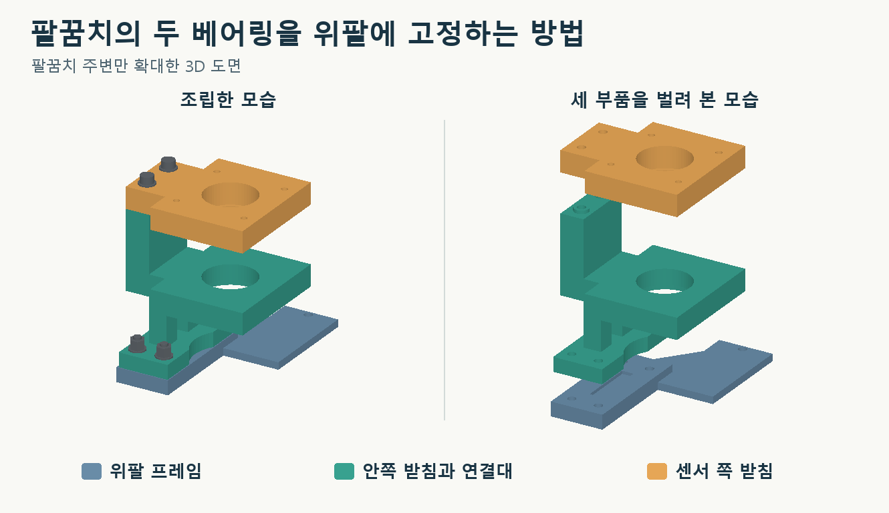

# 팔꿈치 베어링 받침을 위팔 프레임에 고정하는 방법

두 베어링은 위팔에 고정되고, 그 안에서 금속 축과 아래팔 프레임이 돌아간다. 벨트와 팔꿈치 톱니바퀴는 두 받침 사이에 들어간다. 센서 쪽 받침을 분리할 수 있게 해 벨트와 축을 끼울 자리를 확보했다.

## 세 부품의 역할

| 그림 | 부품과 연결 |
|---|---|
| 파란색 | **위팔 프레임.** 팔꿈치 끝의 고정면을 넓히고 M4 볼트 구멍 4개를 냈다. 볼트 머리는 팔을 향하는 면에서 0.3 mm 안쪽으로 들어간다. |
| 초록색 | **팔 가까운 쪽 베어링 받침과 연결대.** 아래쪽 발을 위팔 프레임에 볼트 4개로 고정한다. 연결대는 벨트 뒤쪽으로 돌아 반대쪽 받침까지 이어진다. |
| 주황색 | **센서 쪽 베어링 받침.** 연결대 끝의 돌기 2곳에 얹고 볼트 2개로 조인다. 한쪽 구멍은 둥글고 다른 쪽은 두 돌기를 잇는 방향으로 길어, 조립 시 두 구멍이 서로 밀지 않도록 했다. 이전 설계의 베어링 덮개를 고정하는 M3 볼트 4개는 별도로 들어간다. |

## 추가 체결물

| 위치 | 볼트 | 와셔 및 너트 |
|---|---|---|
| 위팔 프레임 ↔ 초록색 연결대 | M4 × 20 육각머리 4개 | M4 평와셔 4개, 풀림 방지 너트 4개 |
| 초록색 연결대 ↔ 센서 쪽 받침 | M4 × 25 육각구멍 원통머리 2개 | M4 평와셔 2개, 풀림 방지 너트 2개 |

이 연결부에 필요한 수량은 볼트·와셔·너트 각각 6개다. 기존 보유분과 대조해 부족분만 구매 목록에 반영한다. 조립 검토에 쓴 공칭 치수는 육각머리 맞변 7 mm, 평와셔 외경 9 mm·두께 0.8 mm, 너트 높이 5 mm다. 길이 20 mm 볼트가 너트 밖으로 나오는 길이는 약 1.3 mm, 길이 25 mm 볼트는 약 3.9 mm다. 가격·납기는 미확정이다. [M4 × 20 볼트 제조사 규격 예](https://eshop.wuerth.de/Hexagon-bolt-with-thread-up-to-the-head-ISO-4017-steel-88-plain-SCR-HEX-ISO4017-88-WS7-M4X20/00554%20%2020.sku/en/US/EUR/)

## 조립 순서

1. 위팔 프레임의 팔 쪽 면에서 육각머리 볼트 4개를 넣는다. 초록색 연결대의 발을 볼트에 끼운 뒤 와셔와 너트를 올린다. 너트는 발 양옆에서 스패너로 접근한다. 이때 아래팔 프레임은 분리해 둔다.
2. 연결대 뒤쪽에서 풀림 방지 너트 2개를 옆으로 밀어 넣는다. 바깥쪽 받침을 열어 둔 상태에서 팔 쪽 베어링, 축, 허브, 풀리와 벨트를 배치한다. 센서 쪽 베어링의 안쪽 고정링과 간격링을 끼운다. [축 고정 순서](../axial_retention/축_고정_설계.md)
3. 센서 쪽 받침에 덮개용 M3 볼트 4개를 먼저 끼운다. 받침을 축 방향으로 밀어 연결대 돌기 2곳에 맞춘다. 바깥에서 M4 × 25 볼트와 와셔 2세트를 넣어 뒤쪽 너트에 고정한다. 센서 쪽 베어링·남은 간격링·고정링·덮개를 조립한다.
4. 전원을 끈 상태에서 축이 두 베어링을 억지로 누르지 않고 돌아가는지, 기준 위치에 있던 벨트가 한쪽으로 쏠리는지 확인한다. 피부를 향한 볼트 머리와 패드의 실제 위치는 착용 전에 대조한다.

## 3D 도면에서 확인한 범위

| 검사 | 결과 |
|---|---|
| 벨트와 톱니바퀴 | 공칭 위치에서 벨트가 차지할 공간과 새 받침·체결물의 최소 간격 **3.85 mm**, 이 단계에서 팔꿈치 풀리 외형과 받침·체결물 사이 최소 간격은 **3.00 mm**였다. 11월 25일 추가한 아래 케이스 턱과 풀리 사이 공칭 간격은 **1.40 mm**다. |
| 아래팔 움직임 | 0–120°를 1° 간격으로 검사했다. 아래팔 프레임·두 팔 받침·체결물 외형과 고정부 사이에서 가장 좁은 간격은 **약 2.46 mm**였다. 각도 표본 중 12°에서 아래팔 프레임과 연결대 사이에 이 값이 나왔다. |
| 베어링 정렬 | 두 자리 모두 축 중심 (0, 0)에 놓이고 최신 도면의 베어링 중심 간격은 38.5 mm다(이전 40 mm). [변경 도면](../bearing_seats/베어링_자리_조립.md) 지름 8 mm의 돌기와 깊이 2 mm의 구멍은 센서 쪽 받침을 다시 끼울 때 위치를 잡아준다. 실제 동심도와 베어링 끼워맞춤은 출력 오차·변형을 포함해 측정해야 한다. |
| 나사와 공구 | 프레임 볼트 삽입, 너트 옆면 삽입, 바깥쪽 볼트 삽입 경로와 스패너·렌치의 접근 공간을 검사했다. 시판 공구 손잡이 전체와 실제 조임력은 실물 확인 항목이다. |

받침에 체중이나 구동 하중을 가했을 때의 휨·파손, 벨트 흔들림, 피부·옷·전선과의 접촉은 이 수치에 포함되지 않는다. 이전 축 부품을 포함한 조립 STEP을 다시 열어 형상 유효성, 본체 38개, 내보내기 전후 체적을 확인했다. 그림에는 연결을 보여주는 세 부품을 강조했다. 11월 24일에 멈춤홈과 케이스 지지대를 통합했다. 다음 조립에는 [벨트 보호덮개와 멈춤핀 조립 안내](../guard_and_stops/덮개와_각도제한_조립.md)을 사용한다.

[전체 조립 검토 STEP](UPPER_BEARING_MOUNT_ASSEMBLY_REVIEW.step) · [위팔 프레임](UPPER_FRAME_MOUNT_REVIEW.step) · [안쪽 받침과 연결대](HUB_SIDE_BEARING_TOWER_REVIEW.step) · [센서 쪽 받침](SENSOR_SIDE_BEARING_MOUNT_REVIEW.step)
