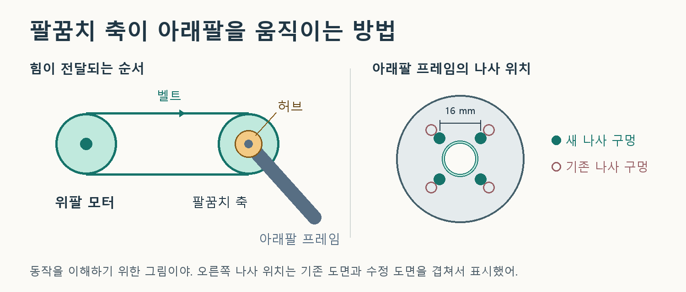

# 팔꿈치 관절 부품과 견적

**Second Muscle · 2026년 11월 25일 갱신 · 착용형 시제품 1세트 검토**

11월 25일에 팔 받침을 분할형으로 바꾸고, 팔꿈치 양쪽 베어링 받침·센서 덮개·벨트 아래 케이스의 자리를 수정했다. 한쪽 팔에 가운데 받침 4개와 공통 조각 18개를 쓴다. 이번 베어링 자리 변경에 추가 구매 부품은 없다. 끈·패드·봉제·출력 견적은 미확정이다. [팔 받침](segmented_cuffs/팔받침_조립.md) · [베어링 조립](bearing_seats/베어링_자리_조립.md) · [전체 출력 목록](3D출력_검토.md)

**일정 반영.** 업체 답변을 기다리지 않고 설계를 진행한다. 아래 문의문은 선택 사항이다. 기존 goBILDA 허브는 설계 후보로 유지한다. 제조사는 고토크 용도라고 설명하지만 12 mm 원형 축에서의 허용 전달 토크 수치를 제품 페이지에 제시하지 않았다. 실제 하중에서의 미끄러짐과 즉시 정지를 모형 팔에서 검증하기 전에는 착용 동력 시연을 진행하지 않는다. [제조사 제품 설명](https://www.gobilda.com/1310-series-hyper-hub-12mm-bore/)

디바이스마트에서 찾은 대안인 NEXUS NX-18017은 부가세 포함 20,570원, 해외 평균 준비 1주일로 표시된다. 축 안지름은 12 mm지만 4 mm 키홈이 있는 축을 사용하며, 지름 47.5 mm 원 위에 체결 구멍이 6개라 현재 프레임의 4개 구멍과 맞지 않는다. 제조사 자료에서도 허용 전달 토크 수치를 확인하지 못했다. 이번 설계의 구매 목록에는 추가하지 않는다. [디바이스마트](https://www.devicemart.co.kr/goods/view?no=1330239) · [제품 치수도](https://www.vstone.co.jp/products/nexusrobot/download/nexus_18017.pdf) · [제조사 사양](https://www.nexusrobot.com/product/12mm-key-hub-18017.html)

위팔에 고정한 모터가 벨트를 돌린다. 벨트는 팔꿈치 톱니바퀴를 돌리고, 톱니바퀴 안의 부시가 힘을 금속 축에 전한다. 축을 잡고 있는 허브와 그 허브에 볼트로 고정한 아래팔 프레임이 함께 회전한다. 베어링 2개는 축이 흔들리지 않고 돌도록 양쪽에서 받친다.

## 견적을 받을 부품

아래는 팔꿈치 구동부의 추가 후보 수량이다. 이미 구매 요청한 모터는 제외했다. 재고, 실납기, 기관 후불, 전자세금계산서는 이번 품목으로 견적을 받아야 확정된다.

| 부품 | 수량 | 견적 요청 기준 | 선택 근거 |
|---|---:|---|---|
| 팔꿈치 톱니바퀴 | 1 | OPTIBELT TB 36 5M 15, RS 239-5279 | HTD 5M, 36개 이, 벨트 폭 15 mm. 부시 형식 1108. [제조사 치수표](https://docs.rs-online.com/fcc7/A700000008663087.pdf) · [국내 판매 페이지](https://kr.rs-online.com/web/p/belt-pulleys/2395279) |
| 톱니바퀴와 축을 묶는 부시 | 1 | OPTIBELT 1108-12, RS 236-8491 | 위 톱니바퀴와 같은 1108 형식, 축 지름 12 mm, 길이 22 mm. 체결나사·평행키 동봉 여부는 확인 대상. [판매사 사양](https://kr.rs-online.com/web/p/taper-lock-bushes/2368491) |
| 타이밍벨트 | 1 | Gates PowerGrip HTD 475-5M-15, 단면 톱니 | 길이 475 mm, 95개 이, 폭 15 mm. 양쪽 모두 36개 이, 축 간격 147.5 mm일 때 이론 길이 475 mm. 실물의 장력 조절 여유는 별도 확인. [Gates 카탈로그](https://www.gates.com/content/dam/documents-library/catalogs/industrial-power-transmission-catalogue-en.pdf) |
| 베어링 | 2 | NSK 6001 | 안지름 12, 바깥지름 28, 폭 8 mm. 두 받침의 자리 치수와 대조. 받침과 덮개는 별도 부품. [NSK 규격](https://www.nsk.com/engineering/products/bearings/ball-bearings/deep-groove-ball-bearings/single-row-deep-groove-ball-bearings/6001-apn.html) |
| 아래팔 프레임을 돌리는 허브 | 1 | goBILDA 1310-0016-0012 Hyper Hub, **12 mm 원형 축용** | 제조사 3D 도면에서 몸체 길이 20 mm, 앞쪽 중심 돌출부 지름 14 × 길이 2 mm, M4 나사 네 개의 상하·좌우 간격 16 mm 확인. 권장 조임 조건과 12 mm 강철 원형 축에서 미끄러지기 시작하는 토크 자료 요청. [제조사 제품 및 도면](https://www.gobilda.com/1310-series-hyper-hub-12mm-bore/) |
| 금속 회전축 및 키 | 각 1 | 지름 12 × 길이 80 mm의 키홈 축, 센서 쪽 고정링 홈 2곳, 끝면 중심 M3 × 0.5 나사 구멍 1곳 | 고정링과 간격링으로 축을 잡고 끝면 나사로 자석 받침을 고정한다. 가공 공차와 공급 형번은 확정 전이다. [축 고정 부품](axial_retention/축_고정_설계.md) · [나사 구멍을 반영한 축](sensor_mount/SENSOR_END_SHAFT_REVIEW.step) |
| 축 고정용 소형 부품 | 1세트 | 축용 DSH-12 고정링 2개, 12.1 × 15 × 1 mm 금속 간격링 2개, 덮개용 M3 × 20 육각볼트 및 풀림 방지 너트 각 4개 | 신규 설계의 소요량을 반영했다. 재고·가격 확인 전이다. 기존 6001 베어링 2개 중 센서 쪽 1개에 조립한다. |
| 위팔 프레임 ↔ 베어링 받침 체결물 | 1세트 | M4 × 20 육각머리 4개, M4 × 25 육각구멍 원통머리 2개, M4 평와셔와 풀림 방지 너트 각 6개 | 보유분 차감 전 수량이다. 센서 쪽 덮개용 M3 세트와는 별도다. [받침 조립도와 수량](upper_bearing_mount/위팔_받침_조립.md) |
| 벨트 케이스와 뚜껑 체결물 | 각 7개 | M3 × 12 육각구멍 원통머리 볼트, M3 풀림 방지 너트 | 케이스 3곳, 뚜껑 4곳. |
| 팔꿈치 멈춤핀 | 1세트 | ISO 7379 Ø6 × 12 / M5 어깨볼트, M5 평와셔, 높이 4 mm M5 육각너트 각 1개. 금속 나사 풀림 방지제 보유분 확인 | 모형 팔용 임시 설계. 구매 형번 및 가격은 확정 전이다. [설계와 조립 순서](guard_and_stops/덮개와_각도제한_조립.md) |
| 센서·자석 고정용 소형 부품 | 1세트 | 황동 접시머리 M3 × 10 1개, 황동 접시머리 M2 × 8 및 M2 너트 각 2개, 나일론 M2 × 10 및 너트 각 3개, M3 × 16 나사·평와셔·너트 각 2개, 접착제 소량 | 기존 Grove AS5600과 9042 자석용. 보유분 차감·실제 머리 치수·가격 확인 전. 출력은 덮개 1개 교체, 새 형상 3개 추가. [조립도와 치수](sensor_mount/각도센서_조립.md) |

**예산.** 프로젝트 장부의 예상 잔액은 239,170원이다. RS 국내 페이지에 보인 톱니바퀴 25,603.72원과 부시 15,040원의 합은 약 40,644원이다. 톱니바퀴 페이지에는 2025년 배송 안내가 남아 있어 두 가격 모두 참고용이다. 다른 부품, 고정물, 출력비, 부가세와 배송비를 포함한 최종 금액은 미정이다.

## 아래팔 도면에서 확인한 것

- 기존 아래팔 프레임의 나사 간격은 약 22.63 mm였다. 시판 허브에 맞춰 16 × 16 mm로 바꾸고, 지름 4.5 mm 구멍 4개를 냈다. 기존 구멍에 새 구멍을 추가하면 가장 가까운 두 구멍 사이에 약 0.19 mm만 남아, 이번 도면에는 새 위치의 구멍만 넣었다.
- 중심에는 지름 12.4 mm 관통구멍을 두고 허브 쪽 면에 지름 14.2 mm, 깊이 2.2 mm의 얕은 홈을 냈다. 제조사 3D 모델에서 허브 돌출부가 이 홈으로 들어가고 네 나사 중심이 일치했다. 홈과 나사 구멍 사이의 가장 얇은 부분은 약 1.96 mm다. 볼트 장력과 반복 하중을 받을 때의 강도는 계산·실험 전이다.
- 허브를 프레임에 밀착시키고 팔 쪽 베어링을 설계 위치에 놓으면 허브 뒷면과 베어링 끝면은 3.50 mm 떨어진다. 허브 쪽 입구는 Ø32 mm, 깊이 3.5 mm다. 허브와 받침의 가장 가까운 곳은 별도로 검사했다. [받침과 케이스 변경 도면](bearing_seats/베어링_자리_조립.md)
- 시판 톱니바퀴의 전체 폭은 22 mm, 두 베어링의 서로 마주 보는 면 사이는 공칭 30.5 mm다. 톱니바퀴와 팔 쪽 베어링 사이에는 3.5 mm, 센서 쪽에는 5 mm가 있다. 센서 쪽에는 기존 고정링과 간격링이 들어간다. 팔 쪽 바깥 링이 앞뒤로 움직일 공간을 둔다.
- 허브와 멈춤핀 체결을 모두 반영한 [최신 아래팔 프레임 STEP](guard_and_stops/FOREARM_STOP_MOUNT_REVIEW.step)은 단일 부품으로 다시 열어 확인했다. CAD 검토 범위는 나사 위치와 부품 배치다. **최종 출력 주문은 보류**한다.

## 한 번에 제작하기 전에 남은 항목

1. 허브와 축이 설계 하중에서 미끄러지지 않는지 확인한다. 프로젝트 장부의 잠정 출력 목표는 5–6 N·m다. 실제 모터가 고장 상황에서 낼 수 있는 최대 힘, 충격, 반복 하중까지 고려한 사용 조건은 별도로 검토한다.
2. 축 빠짐 방지, 베어링 받침, 벨트 보호덮개와 회전 제한 부품에 이어 센서와 자석 고정 위치를 도면에서 검토했다. 최종 출력 전에는 DM4340P 실물의 고정 구멍·커넥터·동봉선을 모터판과 대조하고 출력 치수와 비용을 확인한다. 센서 간격과 각도값은 조립 후 모형 팔에서 실측한다. [축 고정](axial_retention/축_고정_설계.md) · [베어링 받침](upper_bearing_mount/위팔_받침_조립.md) · [벨트 덮개](guard_and_stops/덮개와_각도제한_조립.md) · [센서·자석](sensor_mount/각도센서_조립.md)
3. 조립 후 같은 로봇을 팔 모형에 고정해 하중을 걸고 미끄러짐·변형·걸림과 즉시 정지를 시험한다. 팔에 착용해 모터를 켜는 시연은 팔꿈치 축 정렬과 각도 제한, 독립적으로 작동하는 정지 수단을 포함해 지도교원 또는 실험실 담당자와 검토한 뒤 결정한다. [착용형 팔꿈치 보조기 연구의 기계적 각도 제한 사례](https://doi.org/10.1016/j.ergon.2024.103660)

## 기관 구매 견적이 필요할 때 쓸 문의 초안

안녕하세요. 앞서 DM4340P 모터 구매를 요청드린 조선대학교 팀입니다. 팔꿈치 관절에 추가할 OPTIBELT TB 36 5M 15와 1108-12 각 1개, Gates 475-5M-15 벨트 1개, NSK 6001 베어링 2개, goBILDA 1310-0016-0012 허브 1개의 공급 가능 여부를 부탁드립니다. 1108-12용 체결나사와 평행키가 포함되는지도 알려 주시면 감사하겠습니다. 허브는 지름 12 mm 강철 원형 축에 사용할 예정으로, 권장 조임값과 전달 가능한 토크 자료가 있으면 함께 부탁드립니다.

지름 12 mm, 길이 80 mm인 키홈 회전축에 축용 고정링 홈 두 곳과 한쪽 끝면 중심의 M3 × 0.5 나사 구멍 한 곳(유효 나사 깊이 7 mm 이상, 기초 구멍 Ø2.5 × 깊이 9.5 mm)이 필요합니다. 이 축과 DSH-12 고정링 2개, 내경 12.1 × 외경 15 × 두께 1 mm 금속 간격링 2개, M3 × 20 육각머리 볼트 및 풀림 방지 너트 각 4개의 공급 가능 여부와 대략적인 단가·준비 기간도 부탁드립니다. 공급 가능한 품목별 단가, 부가세·광주 배송비 포함 총액, 예상 수령일, 조선대학교 산학협력단 명의 후불 및 전자세금계산서 발행 가능 여부를 알려 주시기 바랍니다. 감사합니다.
